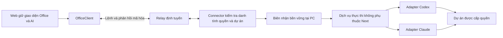

# LioOps kế hoạch giao việc qua Connector

Ngày chốt: 05/11/2026. Trạng thái: kế hoạch cho mốc E, F và G. Kênh Connector hiện có quan sát C/D; giao việc qua Connector chưa được triển khai. Kế hoạch tổng thể tại [PUBLIC-BETA-PLAN.md](PUBLIC-BETA-PLAN.md) tiếp tục là tài liệu điều phối các mốc.

Mục tiêu phát hành là một website LioOps miễn phí, giữ văn phòng và không gian AI hiện có. Người dùng cài Connector trên PC một lần, chọn dự án, đăng nhập provider nếu cần và cấp quyền. Sau cấu hình, Connector chạy nền; người dùng mở web để quan sát và giao việc. Không cần tải repo, tự cài Node/npm, mở terminal, mở server Office hoặc giữ cửa sổ Codex desktop hoạt động.

Mỗi người ghép với Connector và tài khoản AI trên PC của chính họ. Website chung không làm tác vụ của mọi người chạy bằng Codex, dự án hoặc tài khoản của người vận hành LioOps.

## 1 Trạng thái làm cơ sở

| Phần | Đã có | Cần làm tiếp |
| --- | --- | --- |
| Bản local | Giao việc Codex/Claude, workspace riêng, duyệt, dừng và biên nhận qua HTTP/tunnel | Giữ làm đường hồi quy khi tách dịch vụ thực thi |
| Connector C/D | Ghép và quan sát mã hóa, phạm vi dự án, log, token/context, quota có nguồn và CPU/RAM theo quyền | Bổ sung điều khiển tác vụ với quyền riêng |
| Độ sẵn sàng D | 236 unit: 233 đạt, 3 bỏ qua; 7 ca web và 4 ca local chọn theo phạm vi đạt | Hai PC vật lý, mạng ngoài, ngủ/thức và chạy dài 8 giờ |
| Hiệu năng | Có phép đo ngắn tiến trình Node Connector trên log giả | Đo cả cây tiến trình, tải thực và độ trễ đổi quyền; từng ghi nhận bước chậm hàng chục giây trong test tổng hợp |
| Phát hành | Source và build thử riêng | Bộ cài, tự chạy nền, cập nhật ký số, cấp route public và hosting production |

Các kết quả D được ghi trong [OBSERVATION-D.md](OBSERVATION-D.md) và `test-results-release-checks/d-summary.json`. E có thể phát triển với fixture riêng trong lúc hoàn thành nghiệm thu thực tế D. Các cổng thực tế còn thiếu phải đạt trước phát hành công khai.

## 2 Trải nghiệm người dùng

Lần đầu trên PC: **mở web → Kết nối máy tính → tải/cài Connector → chọn dự án và provider → ghép, cấp quyền → vào văn phòng**. Nếu Codex/Claude chưa đăng nhập, phần cấu hình dẫn người dùng qua luồng đăng nhập chính thức tại PC. Không yêu cầu nhập token AI vào website LioOps. Windows hoặc provider có thể yêu cầu xác nhận riêng trong lần đầu.

Những lần sau: **mở web → chọn dự án và Codex/Claude → nhập prompt/ảnh → gửi → theo dõi và trả lời yêu cầu duyệt khi cần**. Kết quả thuộc không gian AI riêng, không tự đăng vào chat Công ty. Các phiên bên ngoài vẫn có thể được quan sát; quyền điều khiển chỉ áp dụng cho tác vụ Connector quản lý.

Khi PC tắt hoặc mất mạng, web báo ngoại tuyến và khóa gửi mới. Việc đã được PC nhận có thể tiếp tục chạy; mở lại web sẽ tra trạng thái cũ. Web không giữ một hàng đợi prompt để tự chạy khi PC trở lại.

Tùy chọn hiện hội thoại trong Codex desktop là quyền mở ứng dụng riêng tại PC, mặc định tắt cho Connector mới. Chạy tác vụ không phụ thuộc tùy chọn này. Việc mở một thread mới không có nghĩa chèn prompt vào cuộc trò chuyện khác đang mở trong desktop.

## 3 Kiến trúc thực thi

Connector chạy dịch vụ Node độc lập. Nó không import hoặc khởi động `server/index.mjs`, Next, React hay Three; không proxy lệnh về cổng 4310. HTTP local và Connector gọi cùng dịch vụ thực thi qua adapter riêng. Chỉ các thao tác có tên, schema, quyền và giới hạn được mở trên kênh mã hóa; không chuyển toàn bộ 71 API local thành RPC remote.

Quản trị máy, chuyển tài khoản, cấu hình tunnel, dọn tiến trình và các API quản trị cũ tiếp tục thuộc local. Rewrite prompt có gọi model cũng là thực thi, chỉ được mở khi có contract/quyền riêng. Các công việc mới qua Connector mặc định thuộc không gian AI riêng; lịch sử chat Công ty cũ được giữ.

| Mã hiện có | Cách sử dụng trong E | Việc cần tách hoặc bổ sung |
| --- | --- | --- |
| `server/providers/codex.mjs` và các module Codex liên quan | Tái sử dụng App Server adapter, ownership, model catalog, duyệt và dừng đúng lượt | Chế độ chỉ quản lý việc của Connector; không tự dò mọi thread ngoài phạm vi |
| `server/tasks.mjs` | Tái sử dụng phần chạy Claude | Tách callback, hook/IPC và duyệt khỏi server Office; không yêu cầu 4310 hoạt động |
| `server/task-requests.mjs` | Tái sử dụng nguyên tắc lưu trước chạy, cùng ID không chạy lại và trạng thái uncertain | Thêm namespace theo PC/peer/dự án/provider; nhận diện chuẩn bị và xác nhận lệnh |
| `server/workspace.mjs` | Tái sử dụng vòng đời hội thoại và lưu local | DTO remote chỉ gửi trường được phép; phân trang và giới hạn byte |
| `server/index.mjs` | Giữ HTTP, xác thực local và tương thích API cũ | Chuyển điều phối tác vụ sang service chung theo từng bước |
| `src/office/net/task-request.js` | Giữ cách gửi một lần và tra biên nhận | Tách pending ID/digest theo Connector và dự án; không tra nhầm PC sau đổi kết nối |
| `src/office/ui/workspace.js`, `task-sheet.js`, `permissions.js` | Giữ giao diện và trải nghiệm đã có | Bật theo capability đã xác thực; bổ sung trạng thái remote và quyền thiếu |
| `connector/`, `relay/`, `src/shared/remote/` | Giữ ghép khóa, mã hóa và quan sát | Thêm protocol thực thi, kênh điều khiển, admission và quản lý tác vụ |

Các module mới dự kiến gồm `server/execution/` cho service chung, `connector/execution.mjs` cho kiểm tra quyền/dispatch, và contract thực thi trong `src/shared/remote/`. Chỉ tạo module khi có hành vi và kiểm thử thực tế; không tạo thư mục rỗng để đánh dấu tiến độ.

## 4 Quyền và phạm vi

Quyền giao việc mặc định tắt, được cấp tại PC cho từng dự án và provider. Quyền quan sát của C/D không tự trở thành quyền thực thi.

| Quyền | Phạm vi |
| --- | --- |
| Quan sát và nội dung | Giữ các lựa chọn D; nội dung tắt thì không mở gửi mới hoặc duyệt từ web |
| Giao việc | Tạo và nhắn tiếp tác vụ quản lý trong dự án/provider đã chọn |
| Duyệt | Chỉ phản hồi yêu cầu hiện hành của đúng tác vụ/lượt; không tạo luật luôn cho phép từ web |
| Dừng | Chỉ tác vụ Connector quản lý; chủ PC luôn có đường dừng tại PC |
| Mở ứng dụng | Tùy chọn riêng, mặc định tắt; không phải điều kiện chạy tác vụ |
| Quota và CPU/RAM | Giữ quyền riêng; đổi các quyền này không tự nâng quyền chạy lệnh |

Web gửi ID dự án opaque. PC ánh xạ sang grant và kiểm tra lại realpath, dev/ino, provider và quyền ngay trước khi gọi provider. Không nhận đường dẫn dự án, đường dẫn binary, biến môi trường, URL API hoặc mức sandbox tùy ý từ browser.

Chọn đúng `cwd` không tự tạo sandbox. Adapter phải kiểm chứng khả năng giới hạn thao tác file/công cụ và chính sách duyệt trên Windows. Không sao chép chế độ Full access của một cửa sổ Codex khác. Khả năng chưa đảm bảo được không được quảng cáo hoặc bật mặc định. MCP/công cụ bên ngoài và tiến trình không thuộc provider không được coi là đã kiểm soát chỉ vì provider nhận lệnh hủy.

Phiên quan sát bên ngoài không có quyền resume/steer/stop. E1 chỉ tạo tác vụ mới. E2 có thể bổ sung fork rõ ràng; không dùng trạng thái nghỉ ước lượng từ log để kết luận có thể tiếp quản phiên gốc. Bản local và Connector phải giữ ownership riêng, tránh hai controller cùng sửa một lượt.

## 5 Contract và biên nhận

### Phiên bản và kênh truyền

Chọn protocol thực thi mới, dự kiến version 3. Protocol 1/2 vẫn phục vụ hồi quy quan sát. Trong phát triển, E dùng kho ghép riêng, dự kiến `identity-e.json`; không ghi đè vault C/D hoặc chuyển quyền âm thầm. Phiên bản file lưu và phiên bản wire được phân biệt. F gom thành một luồng cấu hình cho người dùng, không yêu cầu họ chọn phiên bản giao thức.

Thông điệp ràng buộc PC, peer, dự án, provider, epoch kết nối, revision quyền, chiều gửi, sequence, thời hạn và request ID. Mã hóa/xác thực dùng thư viện JOSE hiện có, không tự viết thuật toán mới.

Kênh điều khiển phải độc lập với ACK ảnh/snapshot. Duyệt, dừng và biên nhận không được chờ renderer 3D hoặc ảnh truyền xong. Relay vẫn không giải mã nội dung; nếu có nhãn lane để ưu tiên, nhãn chỉ là metadata định tuyến và phải được ràng buộc trong thông điệp đã ký. Mỗi lane có hàng đợi và ngân sách riêng; không dùng queue vô hạn.

### Danh sách thao tác

| Thao tác dự kiến | Chức năng | Giai đoạn |
| --- | --- | --- |
| `execution.metadata` | Dự án được cấp, provider sẵn sàng, model/khả năng được phép | E1 |
| `task.prepare`, `task.commit` | Chuẩn bị yêu cầu và xác nhận khởi chạy bằng ticket PC cấp | E1 |
| `receipt.read`, `task.read` | Tra kết quả nhận việc và trạng thái thực tế | E1 |
| `task.stop` | Yêu cầu dừng đúng tác vụ và lượt | E1 |
| `conversation.read`, `conversation.send` | Lịch sử có phân trang và gửi lượt tiếp theo | E2 |
| `task.steer`, `approval.respond` | Chen lời và trả lời đúng yêu cầu đang chờ | E2 |
| `attachment.begin/chunk/finish/abort` | Chuyển ảnh mã hóa với giới hạn và kiểm tra toàn vẹn | E2 |
| `conversation.fork`, `desktop.open` | Fork phiên ngoài và mở thread trên PC nếu được phép | E2, chỉ bật sau nghiệm thu riêng |

Tên operation phải được chốt trong schema trước triển khai. Đây là hợp đồng dự kiến, không phải endpoint đã tồn tại.

### Gửi một lần và xử lý crash

1. Browser tạo request ID và digest từ payload chuẩn hóa, bao gồm thao tác, dự án, provider, nội dung và manifest ảnh. Namespace pending gắn với danh tính PC và peer. Không chỉ dùng digest chung theo website như đường local hiện tại.
2. `prepare` kiểm tra quyền, khả năng provider, dung lượng lưu và tài nguyên; chưa gọi model. PC cấp ticket ngắn hạn ràng buộc đúng request/digest/epoch/revision.
3. Khi còn kết nối và đúng context, browser gửi `commit` cho ticket đó. PC kiểm tra lại, lưu trạng thái trước khi gọi provider rồi mới khởi chạy. Không tự commit khi khởi động lại hoặc khi PC vừa online.
4. Cùng ID/cùng payload trả lại biên nhận; cùng ID/khác payload bị từ chối. Kiểm tra quyền hiện tại trước cả việc trả cached receipt.
5. Mất ACK chỉ tra biên nhận và tác vụ. Không tự tạo ID mới hoặc tự gọi lại provider. Ticket hết hạn chưa chạy được phân biệt với trường hợp không rõ đã chạy hay chưa.
6. Sau crash, prepare chưa commit hết hạn; trạng thái có thể đã gửi provider nhưng chưa có bằng chứng đầy đủ chuyển `uncertain`. Có thể đối chiếu bằng API đọc và định danh đã biết; không tự resume/start để dò kết quả.
7. Giữ nguyên nguyên tắc registry hiện tại: không âm thầm xóa biên nhận cũ để một ID trở thành việc mới. Khi đạt dung lượng hoặc kho hỏng, chặn thực thi mới và báo lỗi; quan sát vẫn hoạt động.

Không cam kết exactly once khi crash đúng giữa provider nhận lệnh và PC ghi được kết quả. Cam kết kỹ thuật là không tự chạy lại yêu cầu chưa xác minh và có đường đối chiếu rõ ràng.

### Hai loại trạng thái

Biên nhận trả lời câu hỏi **PC đã xử lý yêu cầu gửi hay chưa**. Trạng thái tác vụ trả lời **AI đang làm gì**. `done` của registry hiện có chỉ là phản hồi nhận/từ chối đã lưu, không phải AI hoàn tất. Adapter phải giữ tương thích local và chuyển thành nhãn rõ nghĩa trên web.

Trạng thái request dự kiến gồm `prepared` (chưa chạy), `pending` (đã lưu commit, đang xử lý), `accepted` (đã xác nhận nhận việc), `rejected`, `expired` và `uncertain`. `accepted` có định danh tác vụ để đối chiếu; nó không được hiển thị thành hoàn tất. Định dạng lưu/DTO mới ánh xạ rõ với registry local hiện tại, không đổi nghĩa `done` trong API cũ.

Trạng thái tác vụ cần phân biệt: bắt đầu, đang chạy, chờ duyệt, chờ người dùng, đang dừng, hoàn tất, lỗi, đã dừng và chưa xác minh. Chỉ hiện hoàn tất/đã dừng khi có bằng chứng provider phù hợp; ACK của lệnh dừng không đủ.

### Mất mạng và thu hồi

- Mất mạng browser: việc đã được nhận tiếp tục theo chính sách provider; không nhận việc mới từ draft/queue. Khi nối lại chỉ đối chiếu ID cũ.
- Tắt nội dung: xóa nội dung browser, khóa gửi/duyệt mới; không mặc nhiên đổi việc đã được nhận thành đã dừng.
- Thu hồi thực thi hoặc thu hồi ghép: vô hiệu ticket/lệnh cũ ngay, yêu cầu hủy các việc quản lý thuộc phạm vi bị thu hồi; không đụng tác vụ của ứng dụng khác. Nếu đã gửi provider, theo dõi hủy đến khi xác nhận hoặc báo chưa xác minh.
- Phê duyệt hết hạn/mất kết nối không tự cho phép. Mỗi câu trả lời gắn với task, turn, approval ID và nội dung yêu cầu hiện hành.
- Lỗi lưu quyền/biên nhận: dừng nhận thực thi, báo thay đổi chưa được lưu; không báo đã thu hồi bền vững khi ghi thất bại. Phục hồi sau lỗi lưu là ca bắt buộc trước phát hành.

## 6 Các đợt triển khai E1

| Đợt | Công việc | Đầu ra | Điều kiện kết thúc |
| --- | --- | --- | --- |
| E1.0 | Chốt baseline; checkpoint source; đo trễ ở spawn/DPAPI/I/O, relay, crypto và renderer; xác định giới hạn đang dùng | Báo cáo baseline, trace không chứa nội dung, ngân sách thử | Phân biệt được điểm chậm; không nới kiểm tra bảo mật để làm test xanh |
| E1.1 | Tách điều phối khỏi `server/index.mjs` thành service chung; inject store, provider, callback và clock | Runtime chạy được không Next/Three/4310; local gọi cùng service | Bốn luồng hồi quy local hiện có còn đạt; không đổi task ID/lịch sử/giao diện cũ |
| E1.2 | Chốt protocol 3, quyền PC, DTO, namespace và lane điều khiển; target remote có `projectId` riêng, không giả thành `dir` local | Contract thực thi và capability từ hai đầu đã xác thực | Connection C/D không có quyền ghi; sai peer/dự án/revision/epoch bị chặn tại PC |
| E1.3 | Chuẩn bị/commit, journal và đối chiếu; admission và hết hạn | Một đầu vào thực thi có biên nhận bền vững | Lặp/mất ACK/crash không tự tạo việc mới; kho lỗi/đầy chặn chạy mới |
| E1.4 | Nối Codex qua service chung, chỉ tác vụ quản lý; sandbox, model catalog, kết thúc và dừng | Codex chạy prompt text trong dự án thử, không mở desktop | Sửa file/chạy test đúng dự án; thử vượt phạm vi bị xử lý; dừng chỉ báo xong sau xác nhận |
| E1.5 | Nối browser adapter bằng harness nhỏ, thử qua kênh mã hóa và lỗi có chủ đích | Báo cáo E1 và ca tái hiện từng lỗi | Relay không có bản rõ; hai Connector không điều khiển nhau; local và C/D không hồi quy |

E1 chưa mở nút giao việc đại trà. Nếu đường phê duyệt chưa có UI hoàn chỉnh thì lệnh cần duyệt phải được giữ/từ chối an toàn, không tự chấp thuận. Mốc E chỉ đạt cho người dùng khi E2/E3 tương ứng đã nghiệm thu.

Sau E1.1 thực hiện F0 ở phạm vi nhỏ: thử đóng gói runtime trên Windows sạch để phát hiện sớm phụ thuộc repo, binary, hook và credential helper. F0 có thể xen kẽ phát triển E; chưa phát hành bộ cài cho người dùng ở bước này.

## 7 Giao diện E2 và provider E3

### E2 Giao việc trong không gian AI

- Dùng workspace và bảng giao việc hiện có. Web hiển thị PC, dự án và provider đang được chọn; chỉ bật thao tác mà PC/provider đã cấp khả năng.
- Phân biệt đang chuẩn bị ảnh, đang gửi, PC đã nhận, AI đang chạy, chờ duyệt, đang dừng và chưa xác minh. Lỗi kết nối không biến thành lỗi model hoặc hoàn tất.
- Gửi tiếp vào hội thoại quản lý; chen lời vào đúng turn; fork rõ ràng đối với phiên ngoài. Dừng và câu trả lời duyệt phải gắn đúng lượt, tránh lệnh cũ tác động lượt mới.
- Browser chỉ lưu ID/digest/namespace phục vụ đối chiếu, không tự lưu prompt, ảnh hay câu trả lời bí mật vào storage. Draft mặc định ở RAM. Reload sau mất ACK vẫn tra lại yêu cầu đã gửi.
- Lịch sử dùng trang/cursor có giới hạn byte, không nhét toàn bộ workspace local vào một frame. Nội dung quá dài phải có cách đọc tiếp, không âm thầm cắt prompt trước khi chạy.
- Mở trong Codex trên PC là lựa chọn riêng. Không tự bật ứng dụng hoặc điều khiển một cuộc trò chuyện bất kỳ đang mở.

### E2 Chuyển ảnh

Tái sử dụng xem trước, Ctrl+V và xóa từng ảnh; hỗ trợ prompt chữ, ảnh kèm prompt hoặc chỉ ảnh. Giới hạn ban đầu dự kiến 4 ảnh, tối đa 2 MiB mỗi tệp sau khi chuẩn bị, tính trước base64 và mã hóa truyền tải, 8 MiB tổng; chỉ PNG/JPEG/WebP. UI phải báo rõ nếu không thể chuẩn bị ảnh trong giới hạn, không tự gửi thiếu ảnh.

Ảnh đi qua lane tài nguyên bằng chunk tối đa 64 KiB dữ liệu nhị phân, tối đa 2 chunk đang chờ ACK. Mỗi chunk/frame vẫn phải nằm trong giới hạn wire 256 KiB sau các lớp encoding và JOSE; có ca kiểm tra đúng bytes thực tế.

PC kiểm tra manifest, MIME/magic bytes, kích thước, số lượng và hash toàn ảnh; đặt tên file bằng ID nội bộ. Browser không chọn đường dẫn file ở PC. Tác vụ chỉ commit sau khi đủ ảnh đã xác minh. Staging có ngân sách ban đầu 32 MiB/Connector, hết hạn dự kiến 10 phút; dọn trên abort/revoke/timeout và không chạm thư mục dự án. Retry chunk đã có hash có thể an toàn; retry chuyển ảnh không được biến thành retry khởi chạy model.

Các con số này là giới hạn khởi đầu cần kiểm tra trong E2, không phải thông số đã được triển khai.

### E3 Claude và khả năng theo provider

Claude giữ quan sát D trong lúc xây thực thi. Tách stream/hook/kênh duyệt khỏi HTTP Office; kiểm tra độc lập gửi mới, gửi tiếp, ảnh, câu hỏi, từ chối và dừng trên Windows. Chỉ bật capability đã qua test thật của adapter đó. Nếu chưa đảm bảo chính sách công cụ/phạm vi hoặc xác nhận dừng thì giữ thao tác tương ứng tắt, không dùng kết quả Codex thay bằng chứng cho Claude.

Model, reasoning effort, quota và loại tương tác dùng khả năng provider công bố/adapter đã xác minh. Không tự đổi tài khoản, model, quyền mạng hoặc sandbox để làm tác vụ chạy được. Giới hạn tần suất đang có trong adapter phải được kiểm kê và hiển thị lỗi đúng; không âm thầm bỏ giới hạn khi tách runtime.

## 8 Giới hạn kỹ thuật khởi đầu

| Hạng mục | Quyết định cho vòng đầu |
| --- | --- |
| Số việc | Một việc chạy đồng thời/Connector, một lượt hoạt động/hội thoại; bận thì báo bận, không xếp hàng bí mật |
| Prompt | Tối đa 4.000 ký tự cho E1; kiểm tra trước gửi và tại PC, từ chối thay vì tự cắt. E2 chỉ nâng sau kiểm tra xuyên suốt provider/workspace/wire |
| Lệnh | Payload JSON nhỏ có schema; kiểm tra bytes sau UTF-8 và mã hóa; không nhận shell RPC |
| Chuẩn bị việc | Ticket ngắn hạn theo PC, dự kiến 15 giây; startup/đổi epoch/thu hồi làm ticket cũ hết hiệu lực; kiểm tra độ trễ trước chốt |
| Biên nhận | Giữ nguyên mức 10.000 hiện có làm mốc đầu; đầy thì chặn việc mới, không xóa ID cũ để chạy lại |
| Dữ liệu trả về | Snapshot/event/lịch sử đều có giới hạn byte và cursor; câu trả lời không làm tràn kênh dừng/duyệt |
| Lỗi hạ tầng | Không retry thao tác thực thi một cách mù quáng; query/reconcile và chunk có chính sách riêng |

Mục tiêu thử ban đầu: ACK nhận việc p95 không quá 2 giây qua loopback khi provider đã sẵn sàng, không tính thời gian suy luận AI; thay quyền phải có trạng thái đang lưu và đo riêng. Với HTTPS/4G, chốt ngưỡng từ phép đo thực tế trước phát hành. Nếu ticket/deadline không phù hợp đường truyền thì sửa thiết kế điều khiển có bằng chứng, không bỏ kiểm tra expiry/replay.

Đo riêng Node Connector, helper/khay, provider và browser 3D; đồng thời báo tổng cây tiến trình Connector. Phép đo D khoảng 71,7 MiB peak sampled RSS và 2,31% một lõi trong 30,5 giây chỉ là baseline Node ngắn, không phải ngân sách của bộ cài hay AI. F0 phải chốt ngân sách khởi động/nghỉ/tải trước khi đóng băng phát hành.

## 9 Bộ cài F

| Đợt | Đầu ra | Điều kiện nghiệm thu |
| --- | --- | --- |
| F0 | Chọn runtime/cách đóng gói/credential helper sau probe Windows x64; kiểm tra giấy phép binary provider | Máy thử không Node/repo/Office local vẫn chạy được runtime; biết rõ bộ tải chứa gì |
| F1 | Bộ cài per-user, nhận diện LioOps, runtime kèm theo, cấu hình và chẩn đoán | Không cần terminal; đường dẫn Unicode/khoảng trắng; quyền OS và trạng thái provider được báo đúng |
| F2 | Chọn dự án/provider, ghép một lần, khay và tự chạy khi đăng nhập Windows | Sau reboot chỉ mở web; tắt startup/chia sẻ từ PC được tôn trọng; không bắt mở desktop AI |
| F3 | Bản ký số, manifest/checksum, cập nhật có xác minh và gỡ cài | Update không cắt tác vụ đang chạy; rollback có kiểm tra; uninstall không xóa dự án hoặc đăng nhập AI |

Connector không bao gồm toàn bộ Next/Three và không đẩy yêu cầu vận hành server local cho người dùng. Provider thiếu binary/đăng nhập phải được dẫn qua cách cài/đăng nhập chính thức tại PC; quyết định đóng kèm hoặc tải binary phải qua kiểm tra giấy phép và nguồn phát hành. Không tự thay cấu hình AI toàn máy hoặc tắt bảo vệ Windows.

Nút tải chỉ mở khi có artifact thật đã thử cài, chạy, update và gỡ trên Windows sạch. Mốc phát hành đầu nhắm Windows x64; nền tảng khác được công bố sau nghiệm thu riêng.

## 10 Dịch vụ online và phát hành G

Trước khi phát bộ cài public phải thay cơ chế cấp route nội bộ bằng enrollment dành cho từng thiết bị, có chứng minh sở hữu và giới hạn lạm dụng. Không phân phối admin token toàn cục trong client. Giữ mô hình ghép thiết bị cho lần đầu; chưa thêm tài khoản LioOps, đăng ký email hoặc thu phí vào đường cài đặt.

Web và relay dùng HTTPS thật với origin/CSP phù hợp; relay không giải mã/lưu lịch sử nội dung. HTTPS tạm dùng trong nghiệm thu sớm. Địa chỉ và hạ tầng production ổn định phải sẵn sàng trước phát hành cùng cấu hình update, vận hành và xử lý sự cố.

Lưu trữ bền vững source, lịch sử và credential AI thuộc PC/provider. Browser đã ghép nhận nội dung cần hiển thị trong RAM; relay giữ bản mã tạm và metadata kết nối tối thiểu. Codex/Claude vẫn gửi dữ liệu cần xử lý tới nhà cung cấp AI theo tài khoản người dùng. Mã JavaScript trên hosting là một đầu cuối cần tin cậy; E2EE không thay đánh giá phát hành/chuỗi cung ứng hoặc bảo đảm hosting không thể bị sửa mã độc.

LioOps phát hành miễn phí. Thử một nhóm nhỏ trước mở rộng là bước nghiệm thu chất lượng của bản phát hành miễn phí; không phải gói trả phí hay tính năng thanh toán. Hạn mức/chi phí AI vẫn thuộc provider và tài khoản người dùng.

## 11 Ma trận kiểm thử bắt buộc

| Nhóm | Ca cần đạt |
| --- | --- |
| Quyền và cách ly | Đúng/sai PC, peer, dự án, provider, revision; UUID giống nhau giữa hai Connector; ID ngoài phạm vi; lệnh giả và URL/path/env tùy ý |
| Thứ tự và độ mới | Replay, đảo thứ tự, mất frame, ticket hết hạn, đổi epoch giữa prepare/commit, đổi quyền trước khi provider được gọi |
| Biên nhận | Gửi lặp đồng thời; cùng ID khác payload; mất ACK; reload/đổi PC; store đầy/hỏng/không ghi được |
| Crash | Dừng tiến trình trước/sau lưu, trước/sau gửi provider, trước/sau nhận ID, trước/sau lưu kết quả; không tự chạy lại sau restart |
| Tác vụ | Mới, tiếp tục, chen lời, hai lượt cùng hội thoại, provider thiếu/đăng xuất, thiếu sự kiện hoàn tất, trạng thái chưa xác minh |
| Duyệt và dừng | Allow once, deny, input bí mật, approval cũ/hết hạn, mất mạng khi duyệt, stop trễ không tác động lượt mới, terminal/task ngoài ownership được giữ |
| Phạm vi thực tế | Thử đọc/ghi/chạy công cụ ra ngoài dự án theo sandbox đã chọn; không coi kiểm tra cwd là sandbox OS |
| Ảnh | Dán/xóa, thiếu chunk, đảo/trùng chunk, sai hash/MIME, vượt dung lượng, revoke khi upload, đúng 256 KiB sau JOSE; không chạy model khi ảnh chưa đủ |
| Hồi quy | Local HTTP/tunnel, C/D, OfficeClient, chat Công ty và AI workspace, source demo/unpaired; EN/VI; build local riêng và web export |
| Windows | Máy sạch, Unicode/khoảng trắng, junction/thay thư mục, disk full, startup/stop, khóa màn hình/ngủ/thức, update có việc đang chạy |
| Mạng thật | HTTPS, hai PC độc lập/hai browser profile, điện thoại mạng khác, offline/online và route bị thu hồi |
| Tài nguyên | Khởi động/nghỉ/log lớn/tác vụ/8 giờ; đo cả cây tiến trình Connector, provider và browser riêng; không tăng không giới hạn queue/handle/heap |

Fixture/fake provider là mặc định cho phát triển. Ca model thật dùng dự án thử riêng được chủ PC chọn, có hạn mức và ghi rõ phạm vi. Build hoặc mock trên một PC không thay ca hai thiết bị/4G. G cần đánh giá bảo mật độc lập trước công bố cam kết bảo mật cho công chúng.

## 12 Kỷ luật triển khai và điều kiện bàn giao

Mỗi đợt chỉ thay một phần có đầu ra kiểm tra được: contract, service, store, provider hoặc UI. Trước refactor production tạo checkpoint source loại credential/data, vì workspace hiện không có `.git`. Không tạo lịch sử commit giả; có thể tổ chức lại Git riêng trước khi cần PR/phát hành.

Giữ i18n EN/VI, lỗi có mã rõ nghĩa và module không phụ thuộc vòng vào HTTP/renderer. Không gom mọi lỗi thành offline hoặc thành công. Log kỹ thuật mặc định chỉ có metadata cần thiết, không có prompt/ảnh/token; support bundle phải xem trước rồi mới chủ động chia sẻ.

Chạy kiểm tra phù hợp sau mỗi thay đổi; ở cổng nghiệm thu chạy unit, lint, typecheck, build riêng EN/VI/local và E2E theo phạm vi. Báo cáo ghi case nào đạt, log nào là lượt cuối và thiết bị/mạng nào đã thử. Không dùng số test cũ để đánh dấu tính năng mới hoàn thành. Bản local/.next đang dùng không được thay hoặc khởi động lại chỉ để chạy test.

| Mốc | Có thể bàn giao khi |
| --- | --- |
| E1 | Codex text chạy qua kênh mã hóa với quyền và biên nhận; lỗi/crash không tự chạy lại; local và C/D vẫn đạt |
| E2 | Không gian AI gửi prompt/ảnh, tiếp tục, duyệt, dừng và phục hồi đúng; nhãn trạng thái phản ánh thực tế |
| E3 | Claude có nghiệm thu riêng và capability trung thực; phần chưa hỗ trợ được giữ tắt |
| F | Cài/dùng/reboot/update/gỡ được trên Windows sạch, artifact có xác minh, không cần repo/Node/terminal |
| G | D thực tế và các ca mạng/thiết bị/8 giờ/bảo mật/vận hành đạt; có bản phát hành miễn phí thực sự sử dụng được |

Bước bắt đầu được chốt là **E1.0 rồi E1.1**: có checkpoint và số đo, sau đó tách service thực thi chung. Tiếp theo mới mở quyền/contract và biên nhận thực thi. Cách này giữ sản phẩm cũ hoạt động trong lúc xây đường web + Connector hoàn chỉnh.
