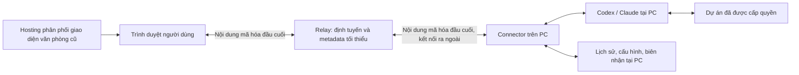

# LioOps — kế hoạch web online và Connector

Ngày chốt: 03/11/2026. Đây là kế hoạch triển khai hiện hành. LioOps phát hành miễn phí; hạn mức và chi phí AI thuộc tài khoản người dùng.

Bản kế hoạch trước được giữ tại [lịch sử](archive/PUBLIC-BETA-PLAN-before-hosted-web.md). Không dùng các ước lượng hoặc thứ tự giai đoạn trong bản đó làm cam kết hiện tại. [Rà soát mã và kiểm thử nền](WEB-CONNECTOR-AUDIT.md) ghi riêng những gì đã kiểm chứng.

## 1. Sản phẩm đã chốt

- Người dùng vào website LioOps online; giữ văn phòng 3D, hoạt động, token và workspace giao việc hiện có.
- Lần đầu mở phần cấu hình: tải Connector cho Windows, cài, cho phép và ghép trình duyệt với PC. Đăng nhập AI nếu máy chưa sẵn sàng.
- Bộ tải chứa Connector, runtime và phần cấu hình/khay cần thiết. Không đóng gói toàn bộ Next/Three vào chương trình chạy nền và không yêu cầu người dùng tải repo, Node hay npm.
- Sau khi được cho phép, Connector tự chạy khi đăng nhập Windows và tự kết nối lại. Các lần sau chỉ cần mở website.
- Connector dùng Codex/Claude tại PC. Không yêu cầu mở cửa sổ Codex desktop để làm việc.
- PC phải bật, có mạng và Connector hoạt động để dùng dữ liệu/tác vụ thật trên web.
- Cài một lần là mục tiêu trải nghiệm; không hứa số lần nhấp cố định. Windows, trình duyệt và đăng nhập AI có thể yêu cầu xác nhận lần đầu.

Bản local tại cổng 4310 tiếp tục được hỗ trợ và là đường kiểm thử hồi quy. Nó không thay thế trải nghiệm web online đã chốt. Công cụ đọc log tại `/observe/` là tiện ích phụ; không đổi nó thành trang chủ.

## 2. Kiến trúc đích



Hosting cung cấp HTML, JavaScript và asset. Nội dung quan sát/giao việc được giải mã tại trình duyệt đã ghép, không đưa vào SSR, server action hoặc log của hosting.

Relay xác thực kết nối và định tuyến thông điệp mã hóa; không giữ khóa giải mã và không biến thành backend đọc dự án/người dùng. Không công khai nguyên server cá nhân hoặc dùng PIN chung cho nhiều người.

Connector kiểm tra quyền tại PC, đọc/chuẩn hóa dữ liệu và điều khiển provider trong phạm vi được cấp. Không mở cổng LAN/router. Không dựa vào việc web HTTPS tự gọi HTTP localhost; phần ghép ban đầu cần thử nghiệm riêng.

Dữ liệu trình bày qua `OfficeClient`; hình vẽ 3D và các panel không tự quyết định đích API. Các adapter gồm local HTTP hiện tại, browser-log chỉ đọc, relay mã hóa và demo rõ nhãn. Adapter chưa có không được tạo thành kết nối giả.

## 3. Quyền riêng tư và giới hạn cam kết

| Loại dữ liệu | Nơi xử lý/lưu |
| --- | --- |
| Source và thư mục dự án | PC và provider theo thao tác đã cho phép; không có API upload toàn dự án tới LioOps |
| Prompt, ảnh, kết quả, lịch sử | Lưu tại PC; chuyển tới trình duyệt đã ghép khi cần; relay không lưu lịch sử nội dung |
| Đăng nhập AI | Do provider tại PC quản lý; không sao chép token lên web/relay |
| Khóa giải mã | Các đầu cuối; khóa của Connector được bảo vệ theo tài khoản hệ điều hành |
| Metadata kết nối | Chỉ định danh/định tuyến, thời điểm, giới hạn tốc độ cần thiết; công bố phạm vi và thời hạn lưu trước phát hành |
| Log hỗ trợ | Mặc định tại PC; người dùng xem trước và đồng ý khi chủ động gửi |
| Dữ liệu demo | Tách biệt, rõ nhãn; không dùng để thay số liệu thật bị thiếu hoặc mất kết nối |

Codex/Claude vẫn liên hệ nhà cung cấp AI để xử lý tác vụ. Cam kết LioOps không thu thập nội dung không có nghĩa tác vụ AI chạy hoàn toàn offline.

E2EE không tự giải quyết mã JavaScript trên hosting bị thay đổi. Trình duyệt phải tin mã giao diện đang giải mã nội dung; script độc hại có thể lấy dữ liệu. Cần CSP, kiểm soát phụ thuộc/phát hành và xem xét ranh giới này trước khi công bố bảo mật; không quảng cáo “bên thứ ba tuyệt đối không thể can thiệp”. [W3C — giới hạn bảo mật Web Crypto](https://www.w3.org/TR/webcrypto-1/#security-considerations)

Không tự thiết kế thuật toán/giao thức mật mã mới. Chọn thư viện và giao thức đã được xem xét, xác minh khả năng chạy ở browser/Node, thử nghiệm ghép khóa và thu hồi trước khi chốt. Mã hóa phải xác thực cả nội dung lẫn nguồn gửi. [OWASP — Cryptographic Storage](https://cheatsheetseries.owasp.org/cheatsheets/Cryptographic_Storage_Cheat_Sheet.html)

Không có giai đoạn phát hành relay chuyển nội dung bản rõ. Tunnel cá nhân hiện có là chức năng cũ; không xem TLS/PIN của tunnel là E2EE.

## 4. Phạm vi quyền ở PC

Mặc định chỉ quan sát. Xem nội dung hội thoại, số liệu máy, giao việc và mở ứng dụng là các quyền riêng, thu hồi được tại PC.

Trình duyệt gửi ID dự án; Connector ánh xạ sang thư mục đã cho phép, kiểm tra realpath/junction/symlink và quyền thực thi. Không cho relay đổi phạm vi hoặc nâng sandbox.

Mọi lệnh phải thuộc danh sách có schema, phiên bản và giới hạn. Không có shell RPC tổng quát hay proxy tùy ý toàn bộ API cũ. Ẩn nút không thay thế kiểm tra tại Connector.

Giao việc chỉ điều khiển tác vụ LioOps quản lý; giữ cơ chế fork với hội thoại ngoài và phê duyệt hiện có. Không tự hạ quyền bảo vệ hoặc dừng tiến trình dựa trên PID đơn lẻ.

Các thao tác dọn máy, chuyển tài khoản, sửa cấu hình provider, tunnel, push và tự động hóa không tự trở thành tính năng remote. Rewrite prompt có gọi model là thao tác thực thi, không phân loại thành đọc.

## 5. Ghép, mất mạng và tính đúng của công việc

Luồng ghép phải chứng minh quyền sở hữu ở PC và trình duyệt, xác thực khóa hai đầu, có yêu cầu một lần/hết hạn/thu hồi và chống đoán. Không dùng mã ngắn làm khóa mã hóa hoặc credential điều khiển dài hạn.

Lựa chọn yêu cầu tài khoản LioOps hay chỉ tin thiết bị phải được chốt sau thử nghiệm pairing; không tự thêm đăng ký/email vào luồng dùng lần đầu. Danh tính AI không thay cho quyền điều khiển Connector.

Thông điệp ràng buộc đúng máy, phiên kết nối, chiều gửi, phiên bản quyền, số thứ tự và ID yêu cầu. Kiểm thử giả mạo, sửa nội dung, replay, đảo thứ tự và reconnect. Việc ghép/thu hồi phải vô hiệu cả lệnh đã cũ.

Connector ghi biên nhận bền vững trước khi thực thi. Cùng request ID/nội dung không tạo hai tác vụ; mất ACK phải đối chiếu trạng thái, không tự gửi thành việc mới. Sau crash không rõ trạng thái thì hiển thị `unknown`, không hứa “exactly once”.

Không tự xếp hàng và chạy lệnh khi PC trở lại online. Phê duyệt mất mạng không được tự cho phép. Chỉ báo đã dừng sau xác nhận từ provider.

## 6. Kế hoạch triển khai theo cổng nghiệm thu

| Mốc | Thay đổi có thể kiểm tra | Điều kiện hoàn thành |
| --- | --- | --- |
| A — kiểm kê và baseline | Danh mục điểm gọi mạng, dữ liệu/quyền, trạng thái kiểm thử và nơi phục hồi mã | Tách rõ đã có/chưa có; thống nhất web online + Connector; không đổi UI/di chuyển dữ liệu |
| B — lớp giao tiếp và nguồn dữ liệu | Contract có phiên bản, `OfficeClient`, adapter local; tách lựa chọn demo khỏi static build | Dữ liệu thật đi qua adapter; lỗi/offline không thành demo; bài hồi quy local đạt; nguồn chỉ đọc không phát sinh lệnh |
| C — một luồng kết nối mã hóa thật | Connector nội bộ, relay thử nghiệm và browser ghép được; xem một phiên thật trong UI cũ | Hai đầu xác thực khóa; sửa/replay/ghép sai bị chặn; relay không có bản rõ/khóa; chưa mở giao việc |
| D — quan sát đầy đủ | Sessions, log, token/ngữ cảnh, quota khi có nguồn, CPU/RAM theo quyền; reconnect/ngủ-thức | Hai máy cách ly; dữ liệu thiếu/cũ hiển thị đúng; có đo tài nguyên và giới hạn hàng đợi |
| E — giao việc từ web | Prompt/ảnh, nhắn tiếp, phê duyệt, dừng, lịch sử và biên nhận tại PC | Không vượt dự án/quyền; không chạy trùng khi mất ACK/crash; dừng đúng tác vụ; provider được nghiệm thu riêng |
| F — bộ cài và trải nghiệm | Runtime đi kèm, cấu hình, khay, tự chạy nền, update có xác minh và uninstaller | Máy Windows mới không Node/repo vẫn cài-dùng-gỡ được; bản ký số, checksum/license; không xóa dự án/đăng nhập AI |
| G — nghiệm thu phát hành miễn phí | HTTPS thật, hai PC/hai trình duyệt, mạng ngoài/điện thoại, tài liệu và vận hành | Các tiêu chí dưới đây đạt; thử nhóm nhỏ để kiểm chứng trước mở rộng; không có chức năng thu phí |

Chạy thử đóng gói/runtime sớm để phát hiện rủi ro Windows, nhưng không phát hành bộ cài trước khi chức năng kết nối thật đạt. Không chốt số ngày hoặc RAM/bộ cài khi chưa đo.

Codex là đường giao việc nghiệm thu đầu tiên vì đã có adapter; Claude giữ cùng contract nhưng khả năng và nguồn quota được báo riêng. Nút tải chỉ mở khi có file thật đã kiểm tra. Không quảng cáo “đã kết nối” chỉ vì một HTTP endpoint trả 200.

[Kế hoạch giao việc qua Connector](EXECUTION-CONNECTOR-PLAN.md) chốt chi tiết E1/E2/E3, probe đóng gói F0, bộ cài F và nghiệm thu G. Bước tiếp theo là đo/chốt baseline rồi tách service thực thi khỏi server local; các mục trong kế hoạch chi tiết là công việc cần triển khai, không phải tính năng đã có.

## 7. B1 — kênh live và lựa chọn nguồn

Phạm vi một thay đổi: chuyển đường nhận dữ liệu live hiện có qua adapter local, giữ nguyên payload và giao diện.

1. Chốt kiểu snapshot/event, capability và trạng thái kết nối ở lớp dùng chung. Không đưa DOM, credential hoặc đường dẫn API vào contract dữ liệu.
2. Tách HTTP/SSE/long-poll khỏi `demo/demo.js`; `applyMsg` tiếp tục cập nhật UI cũ. Hủy subscription/timer khi đổi nguồn.
3. Thêm `OfficeClient` và adapter local dựa trên API cũ, chưa thêm relay giả. Dữ liệu có nguồn/thời điểm; capability chỉ là mô tả phía client, backend vẫn kiểm tra quyền.
4. Tách static export khỏi việc ép chạy demo; chỉ boot nguồn được chọn rõ. Thử public export khi chưa ghép: không chạy dữ liệu mẫu hoặc gọi API PC tự phát.
5. Kiểm tra dữ liệu fixture hiển thị như trước qua SSE và long-poll; lỗi/abort/reconnect không nhân đôi listener hoặc tự chuyển demo.
6. B2 tiếp tục chuyển các API panel theo từng nhóm ở [danh mục rà soát](WEB-CONNECTOR-AUDIT.md). Tính năng chưa chuyển xong phải giữ local hoặc tắt đúng lý do ở remote. B1 mới tách kênh live, không được đánh dấu toàn bộ B đã xong.

Các module B1 đã triển khai:

```text
src/shared/office-source.js          chọn nguồn độc lập với static export
src/shared/contracts/office.js       packet nội bộ, capability, kiểm tra payload legacy
src/office/data/client.js            một subscription, trạng thái, chặn callback cũ
src/office/data/local-http.js        SSE và long-poll có hủy/timeout/cursor
src/office/net/connection.js         nối adapter với UI/replay đang có
```

Contract B1 phục vụ backend local hiện có, chưa là schema/giao thức relay công khai. Ở B1 capability mới mô tả kênh live; B2 dưới đây bổ sung API panel/quyền. Không xem việc có packet version là đã có xác thực hoặc mã hóa.

Các module C hiện có được ghi dưới đây; nghiệm thu và giới hạn ở mục 9. Bộ cài và provider bridge đầy đủ vẫn chưa có:

```text
src/shared/remote/                   schema C, JOSE và mailbox transport
src/office/data/encrypted-relay.js    adapter quan sát có mã hóa, không thực thi
connector/                           core một log, store bảo vệ và consent loopback
relay/                               relay thử có auth, quota và origin/rate limit
packaging/windows/                   CHƯA CÓ: installer, ký số, update/uninstall (F)
```

Không thêm thư mục/module rỗng để tạo cảm giác đã hoàn thành. Mỗi adapter phải có hành vi thật và kiểm thử trước khi nối UI.

## 8. B2 — API panel và quyền

Ngày 04/11/2026: đã chuyển 19 module UI gọi fetch trực tiếp, các API lịch sử/replay/tenure/provider-version và cấu hình sang facade chung. Registry có 71 thao tác local với method/path cố định, validator, capability và phạm vi local-only. Ảnh có resource operation riêng, giữ lazy-loading. Xem [hợp đồng API và bảng sinh từ mã](API-CONTRACT.md).

Client chọn nguồn mà không khởi động stream khi panel cần đọc metadata trước. Context request đổi khi đổi nguồn/đóng client; reconnect stream không đổi context và không hủy yêu cầu giao việc đang chờ ACK. Dispatcher tra biên nhận trên đúng context, giữ định dạng UUID/digest cũ theo origin và không retry request ghi.

Quyền ghi/thực thi lấy từ snapshot backend; lỗi kết nối tạm dừng quyền mới. Hai API quản trị máy được bổ sung kiểm tra loopback tại backend, cùng việc tắt nút phía client khi thiếu quyền. API source demo/browser-log/unpaired không có fallback về PC.

Unit hiện có 202 bài: 199 đạt/3 bỏ qua/0 lỗi; lint không warning, typecheck và build local riêng đạt. 11 E2E local đạt cho workspace Codex/Claude, reconnect/replay, API panel với backend thật, quyền quản trị LAN, prompt coach desktop/phone, PIN/approval/dedupe và managed JWT. Export EN/VI và 4 E2E public web đạt: cấu hình đầu tiên, không gọi API PC khi chưa ghép và nguồn đọc log chỉ đọc. Đây là 15 E2E chọn theo phạm vi, không phải toàn bộ suite. Không có Connector, public relay hoặc mã hóa đầu cuối phát sinh từ đợt B2.

## 9. C — một luồng quan sát có mã hóa

Ngày 04/11/2026: đã triển khai Connector nội bộ không phụ thuộc Next/Three, relay chuyển bản mã trong RAM và adapter `encrypted-relay` đi qua `OfficeClient`. Một log JSONL được chọn tại PC; web chỉ bắt đầu nhận nội dung sau khi so toàn bộ mã browser và cho phép tại trang loopback của PC. Khóa Windows dùng DPAPI CurrentUser; browser dùng CryptoKey không export trong IndexedDB. Xem [giao thức, giới hạn và cách thử nội bộ](ENCRYPTED-OBSERVATION.md).

Public wire schema riêng không mang snapshot legacy hoặc RPC tùy ý. JOSE JWS/JWE kiểm tra khóa peer đã ghim, đúng route/đích/nonce/sequence/quyền và độ mới. Không có dispatcher thực thi trong Connector; `log.read` phía browser đọc cache đã giải mã. Thu hồi và mất kết nối dọn quyền/cache/nội dung UI; reconnect dùng nonce mới. Approval và thu hồi được ghi tuần tự để tránh khôi phục nhầm quyền.

Lõi C đã nghiệm thu nội bộ: 219 unit (216 đạt/3 bỏ qua), 5 E2E public web, 4 E2E local và 1 lượt ca quan sát qua relay HTTPS tạm đều đạt. Lint không warning, typecheck, build local riêng và export EN/VI đạt. HTTPS dùng log fixture và web preview loopback; bản cuối còn kiểm tra hardening quên máy bằng unit/public web. Bằng chứng tại `test-results-release-checks/c-summary.json`. Không dùng kết quả đó để tuyên bố đã có website deploy, hai PC cách ly hoặc phiên provider thật. Mốc C còn cần thử bằng log do chủ PC chọn trong môi trường sử dụng; G cần nghiệm thu vận hành/đánh giá bảo mật riêng. Không có bộ cài, tự chạy nền hay giao việc remote từ thay đổi này. Admin token của relay thử không được phân phối trong bộ cài public.

## 10. Kỷ luật thay đổi và tiêu chí phát hành

Cập nhật D, 05/11/2026: đã có implementation quan sát các dự án được cấp quyền, Codex/Claude, nội dung theo phiên được chọn, token/ngữ cảnh, quota nếu có trong log và CPU/RAM opt-in. Quyền tại PC có revision được lưu và xác thực lại; hai Connector dùng chung relay có ca kiểm tra cách ly. Có cache, giới hạn đọc/queue/wire và đo tiến trình Connector thật trên log giả. [Tài liệu D](OBSERVATION-D.md) và `test-results-release-checks/d-summary.json` ghi kết quả cuối. Chưa nghiệm thu hai PC vật lý/4G, ngủ-thức thật, log thật hoặc đo 8 giờ; không coi kiểm thử nội bộ là đã hoàn tất cổng phát hành. E/F/G vẫn còn.

- Trước refactor production: có checkpoint phục hồi mã rõ ràng, loại dữ liệu cá nhân/credential khỏi bản sao; workspace hiện không có thư mục `.git`.
- Mỗi thay đổi có phạm vi, diff review được, lý do và kiểm thử phù hợp. Không refactor đồng thời branding, scene, chat Công ty và giao thức.
- Giữ i18n EN/VI, tách module theo trách nhiệm, không đưa chi tiết backend vào luồng người dùng.
- Không gộp mọi lỗi thành kết nối thành công; phân biệt chưa cài, chưa ghép, offline, từ chối quyền, provider lỗi và dữ liệu cũ.
- Kiểm tra local cũ và web mới bằng dữ liệu giả/tài khoản thử. Ca AI thật phải có phạm vi rõ; không benchmark ngầm trên dự án của người dùng.
- Máy Windows thường, Unicode/khoảng trắng, junction, ngủ/thức, credential hết hạn, đĩa đầy, biên nhận hỏng và update đang có việc phải có ca nghiệm thu.
- Đo Connector, provider và trình duyệt riêng: khởi động, nghỉ, log lớn, 8 giờ sử dụng. Chốt ngân sách sau mẫu thử; không quảng cáo chương trình nhẹ chỉ dựa trên kích thước installer.
- Hai thiết bị đã ghép đúng được xem/giao việc theo quyền; sai khóa, sai máy, bị thu hồi, thông điệp lỗi hoặc quá giới hạn không được thực thi.
- Quan sát và gửi việc từ điện thoại qua mạng khác phải được kiểm tra thật; localhost/mocks không chứng minh đã online.
- Chỉ đánh dấu hoàn thành mốc khi có kết quả kiểm tra và hạn chế được ghi lại. E2EE có luồng C/D nội bộ; bộ cài và deploy public vẫn chưa hoàn thành.

## 11. Trạng thái tại lần chốt này

Checkpoint trước refactor có 507 file/entry, khoảng 11,2 MB; SHA-256 archive đã kiểm tra lại trước khi sửa. Đường dẫn/phạm vi nằm trong bản rà soát.

Ngày 04/11/2026: đã triển khai và nghiệm thu B1 cho kênh live/lựa chọn nguồn. Unit có 189 bài: 186 đạt, 3 bỏ qua; lint/typecheck, build local riêng và export EN/VI đều đạt. Bốn bài E2E giao việc/remote cũ, hai bài live mới và bốn bài public web đạt (10 bài chọn theo phạm vi, không phải toàn bộ E2E suite). Ca live dùng backend thật, ngắt SSE qua proxy kiểm thử và ngắt mạng long-poll, kiểm tra reconnect/thoát replay. Ca public kiểm tra EN/VI, không gọi API PC khi chưa ghép, không chọn nguồn local bằng query/event và nguồn đọc log chỉ đọc. Không dùng AI thật để chạy các ca này. Bằng chứng tại `test-results-release-checks/b1-summary.json` và các log cùng thư mục.

B2 đã triển khai và nghiệm thu trong phạm vi mục 8; bằng chứng tại `test-results-release-checks/b2-summary.json`. Lõi C đã triển khai/nghiệm thu nội bộ như mục 9, có ca relay HTTPS qua Internet bằng fixture. Không xem prototype đó là Connector/relay/bộ cài đã phát hành. Log thật được chủ PC chọn, cách ly hai PC, triển khai hosting, bộ cài và nghiệm thu vận hành vẫn chưa hoàn thành.

D mở rộng theo tài liệu liên kết ở mục 10. Các giới hạn chỉ một log/không dò phiên ở phần C là baseline protocol 1; D dùng protocol 2 và kho ghép riêng nên quyền C không bị mở rộng tự động. Kết quả mới không thay đổi những ca nghiệm thu vận hành còn thiếu.
