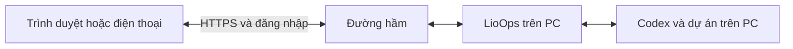
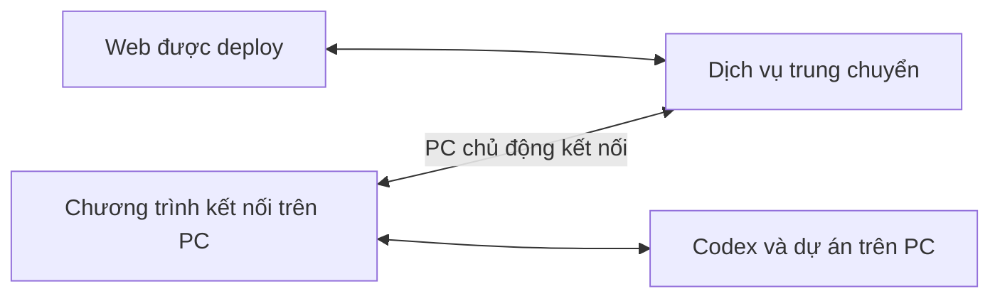

# Kế hoạch gửi prompt online tới Codex trên PC

Lộ trình sản phẩm mới ngày 03/11/2026 nằm ở [kế hoạch beta web và Connector](PUBLIC-BETA-PLAN.md), theo lựa chọn thử miễn phí với nhóm nhỏ. Tài liệu dưới đây giữ lại phạm vi và kết quả MVP truy cập một PC qua tunnel; nó không xác nhận relay nhiều người hoặc Connector đã được triển khai.

Ngày: 02/11/2026. Trạng thái: MVP đã qua kiểm thử tự động và HTTPS thật trên Windows; còn bước xác nhận bằng điện thoại 4G. Theo lựa chọn chủ máy, dùng HTTPS tạm trước, chưa cần tài khoản/tên miền Cloudflare. Xem [hướng dẫn dùng và giới hạn](REMOTE-CODEX.md).

Đã có nút Giao việc, biên nhận chống trùng qua restart, khôi phục mã trong tab HTTPS, nhãn Claude/Codex, vòng đời tunnel Windows và hủy tải/kết nối. Runner HTTPS thật đã đạt 4/4 ca với Codex thực, bao gồm sửa file, duyệt/từ chối, tiếp tục hội thoại, dừng tiến trình và đối chiếu gửi lặp. Phần mã managed tunnel + xác minh JWT Access đã được chuẩn bị để dùng sau; chưa kích hoạt trên tài khoản thật. Relay cloud chưa được triển khai.

## Phần còn lại theo thứ tự

1. Chủ máy xác nhận bằng điện thoại tắt Wi-Fi, dùng 4G theo hướng dẫn. Chưa đánh dấu bước này hoàn thành.
2. Tiếp tục dùng Quick Tunnel cá nhân. Nếu cần địa chỉ cố định, tạo tài khoản/tên miền rồi cấu hình [managed tunnel và Access](REMOTE-MANAGED.md); mã hiện có sẽ dùng các thông tin đó.
3. Chỉ triển khai nhánh frontend cloud + connector khi cần website độc lập với tiến trình Office trên PC. Đây vẫn là một giai đoạn sản phẩm riêng, chưa nằm trong bản hiện tại.

## Mục tiêu và phạm vi đầu tiên

Một người dùng, một PC Windows. Người dùng mở LioOps từ máy khác hoặc điện thoại ngoài mạng nhà, nhập prompt, chọn dự án và giao Codex trên PC thực hiện. Kết quả, phê duyệt, trạng thái, token/context và hạn mức quay về giao diện web.

PC phải bật, có mạng, chạy LioOps và có Codex CLI đã đăng nhập. PC tắt hoặc ngủ thì Codex cục bộ không nhận được việc. Nếu cần thực thi khi PC tắt, phải có một máy khác chạy Codex, chẳng hạn VPS với bản sao dự án.

## Phân biệt các cách đưa web lên online

| Cách | Nơi chạy giao diện/backend | Nơi chạy Codex | Khả năng hiện tại |
| --- | --- | --- | --- |
| Truy cập PC qua tunnel | LioOps vẫn chạy trên PC, trình duyệt truy cập bằng HTTPS | PC của người dùng | Đã triển khai và kiểm thử HTTPS/Codex thật trên Windows; còn xác nhận điện thoại 4G |
| Deploy giao diện riêng trên cloud | Giao diện và dịch vụ trung chuyển trên cloud; có chương trình kết nối trên PC | PC của người dùng | Chưa có lớp kết nối và trung chuyển này |
| Chạy cả hệ thống trên VPS | LioOps và Codex chạy trên VPS | VPS | Cần triển khai Node server, Codex, đăng nhập và dự án trên VPS; không tự truy cập được ổ F: của PC |

`OFFICE_STATIC=1` hiện tạo bản demo với dữ liệu mẫu. Đưa bản demo này lên hosting không kết nối được Codex hay file trên PC. Backend thực tế nằm trong `server/index.mjs`; giao diện Next.js riêng chưa thay thế backend đó.

## Hướng khuyến nghị: MVP cá nhân qua tunnel

Cloudflare Tunnel cho phép PC chủ động thiết lập kết nối ra ngoài để cung cấp ứng dụng cục bộ, không cần mở cổng vào trên modem. [Cloudflare Tunnel](https://developers.cloudflare.com/tunnel/).

### 1. Làm rõ chỗ soạn prompt trên web

- Đưa nút giao việc cho Codex tới vị trí dễ thấy; tái sử dụng bảng Giao việc và API hiện có.
- Chọn dự án, bắt đầu hội thoại mới hoặc tiếp tục hội thoại do LioOps quản lý; chọn model khi cần.
- Hiển thị đang gửi, đang chạy, chờ duyệt, hoàn thành, lỗi và đang dừng.
- Giữ kết quả Markdown, lịch sử trao đổi, ảnh đính kèm và chỉ số token đã có.
- Mỗi lần gửi có một mã yêu cầu; cùng mã không được khởi chạy công việc hai lần khi người dùng thử gửi lại sau lỗi kết nối.

Điểm sửa dự kiến: `src/office/ui/task-sheet.js`, `group-chat-view.js`, các bản dịch và lớp giao việc trong `server/index.mjs`. Backend chống trùng phải xác thực người gửi và dự án trước khi xử lý mã yêu cầu; trạng thái không rõ có được Codex chấp nhận hay chưa phải được đối chiếu, không tự phát lại prompt.

### 2. Hoàn thiện truy cập từ xa đang có

- Dùng luồng Điện thoại → Khi ra ngoài và listener dành riêng cho tunnel, có PIN và phân quyền từ xa.
- Đổi những nhãn còn ghi riêng Claude thành nhãn phù hợp cả Claude và Codex.
- Mặc định quyền giao việc/phê duyệt từ xa tắt; chủ máy bật tại PC.
- Kiểm tra đầy đủ gửi prompt Codex, câu hỏi, phê duyệt/từ chối, chen lời và dừng qua đường truy cập từ xa.
- Giữ cơ chế cập nhật bằng long polling đang có khi dùng Quick Tunnel.
- Vòng đời `cloudflared` trên Windows đã có nhận diện executable/creation marker/command hash, kiểm thử restart và hủy trong lúc khởi động; không dừng PID chưa xác minh. Tải chương trình có thể hủy, chỉ bản tải hoàn tất mới vào cache.

Quick Tunnel phù hợp thử nghiệm; địa chỉ có thể thay đổi, không có bảo đảm uptime và không hỗ trợ SSE. [Giới hạn Quick Tunnels](https://developers.cloudflare.com/tunnel/get-started/quick-tunnels/).

### 3. Giữ đúng ranh giới điều khiển máy

- Mọi yêu cầu từ tunnel vẫn là yêu cầu từ xa dù kết nối nội bộ tới server có địa chỉ loopback; giữ kiểm tra host, origin, PIN và quyền thao tác.
- Chỉ nhận dự án đã được PC xác nhận, không nhận tùy ý đường dẫn từ trình duyệt.
- Giữ sandbox và chính sách phê duyệt Codex hiện tại; trình duyệt không được tự chuyển sang chế độ toàn quyền.
- Chỉ điều khiển tác vụ do LioOps tạo. Với hội thoại ngoài, giữ hành vi tạo bản sao trước khi giao việc.
- Giữ giới hạn phê duyệt lệnh rủi ro từ xa hiện có. Thông tin đăng nhập Codex ở trên PC; không đưa vào bundle web hay log truy cập.
- Khi mạng đứt, hiển thị đang kết nối lại/trạng thái chưa xác nhận. Không tự gửi lại lệnh có thể đã được nhận.

### 4. Điều kiện nghiệm thu MVP

1. Từ thiết bị ở mạng khác/4G: đăng nhập, thấy phiên Codex và số liệu token thực.
2. Gửi prompt đọc dự án, nhận kết quả trên web; kiểm chứng tác vụ chạy tại đúng thư mục trên PC.
3. Gửi yêu cầu tạo/sửa một file mẫu trong dự án thử và kiểm tra file trên PC.
4. Phê duyệt/từ chối khi được cấp quyền; khi tắt quyền giao việc thì yêu cầu từ xa bị chặn.
5. Dừng một lệnh chờ và xác nhận tiến trình kết thúc; terminal từ lượt trước không bị dừng nhầm.
6. Ngắt mạng, tải lại trang và thử gửi lại cùng mã: không tạo hai tác vụ.
7. Người chưa đăng nhập không đọc được phiên, prompt hay gọi API giao việc.
8. Restart trên Windows và tắt tunnel không để lại đường truy cập hoạt động ngoài ý muốn.

Trước hết bổ sung test qua listener tunnel với fixture Windows; sau đó kiểm tra tunnel HTTPS thật và một thiết bị ở mạng khác. Các bài Codex thật trong localhost hiện có không được coi là đã xác nhận luồng qua Internet.

## Sau MVP: địa chỉ ổn định và đăng nhập riêng

Dùng tunnel có quản lý và tên miền cố định. Thêm Cloudflare Access để kiểm tra danh tính trước khi vào LioOps, đồng thời giữ quyền thao tác của ứng dụng. [Mô hình ứng dụng riêng với Cloudflare Access](https://developers.cloudflare.com/cloudflare-one/setup/secure-private-apps/private-web-app/).

Đã chuẩn bị cấu hình hostname/origin HTTPS rõ ràng, token file, kiểm tra JWT Access và tái sử dụng helper gắn với cấu hình. Vẫn dẫn traffic qua listener từ xa, không coi proxy là chủ máy. Cần tài khoản/tên miền/chính sách thực để kích hoạt và nghiệm thu; hiện chưa có và chưa bật.

## Nhánh riêng nếu muốn deploy giao diện độc lập trên cloud

Đây là giai đoạn phát triển thêm, không phải chỉ đổi cấu hình deploy:

- Đăng nhập người dùng; ghép nối PC bằng mã dùng một lần và thu hồi kết nối từ PC.
- Chương trình kết nối trên PC chạy nền, tái sử dụng adapter Codex hiện có và giữ thông tin đăng nhập tại máy.
- Dịch vụ trung chuyển xác thực người dùng/máy, chuyển prompt, kết quả và yêu cầu duyệt tới đúng máy; tách dữ liệu nếu sau này có nhiều người.
- Heartbeat và trạng thái online/offline; đối chiếu trạng thái tác vụ sau reconnect, mã yêu cầu chống chạy trùng.
- Mặc định chỉ giao việc khi PC online; việc tự xếp hàng chạy sau khi máy trở lại cần được thiết kế và cho phép riêng.
- Quy định dữ liệu nào lưu trên cloud. Không lưu token đăng nhập Codex; việc lưu nội dung prompt/kết quả là lựa chọn rõ ràng.

Giao diện cloud có thể vẫn mở khi PC offline, nhưng việc thực thi trên PC vẫn phải chờ PC hoạt động. Với nhu cầu cá nhân hiện tại, ưu tiên hoàn thành và nghiệm thu MVP tunnel trước khi làm nhánh cloud độc lập.
