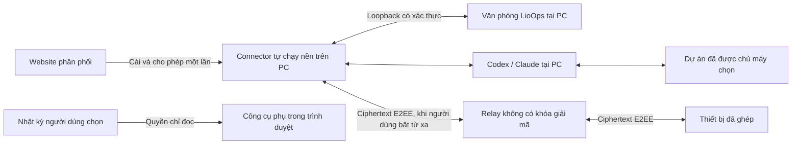

# Kế hoạch lịch sử — không còn là kế hoạch triển khai hiện hành

Lưu trước khi thống nhất web online + Connector ngày 03/11/2026. Tham khảo [kế hoạch hiện hành](../PUBLIC-BETA-PLAN.md); các giả định local-first và ước lượng cũ bên dưới không có hiệu lực triển khai.

---

# LioOps — kế hoạch phát hành miễn phí: web và Connector

Ngày lập: 03/11/2026, múi giờ Việt Nam. Trạng thái: đã khôi phục văn phòng cũ làm trang chủ và bổ sung cấu hình kết nối đầu tiên; đã build EN/VI và kiểm tra luồng cấu hình trên điện thoại, mở văn phòng mẫu và quay lại cấu hình từ Cài đặt. Công cụ đọc log phụ vẫn có parser/Worker và nguồn dữ liệu chỉ đọc cho văn phòng 3D; xem [cách dùng và giới hạn](../OBSERVE-WEB.md). Phần tách lõi chưa hoàn tất toàn bộ G1. Connector đóng gói, bộ cài tự chạy nền/ký số, E2EE và triển khai public chưa hoàn thành; không đánh dấu toàn bộ kế hoạch đã xong.

**Điều chỉnh theo yêu cầu mới nhất:** giữ giao diện văn phòng cũ. Website mở phần cấu hình/kết nối trước, không dùng trang Quan sát riêng làm trang chủ. Hướng chính là cài một lần, cho phép, chương trình tự chạy nền và mở văn phòng local; không yêu cầu terminal hoặc bật Codex desktop thủ công. Nội dung người dùng lưu tại máy. Mã hóa đầu cuối và chống sửa/phát lại thông điệp là điều kiện bắt buộc trước mọi phát hành relay từ xa; không có giai đoạn phát hành relay đọc được nội dung. Trang `/observe/` chỉ còn là công cụ đọc log phụ. Quy tắc này có ưu tiên hơn các giả định cũ bên dưới.

Quyết định mới nhất của chủ dự án: LioOps là sản phẩm phát hành miễn phí cho người dùng, không xây thu phí hoặc gói trả tiền. Nhóm 10–20 người là bước kiểm chứng chất lượng trước phát hành rộng, không phải mô hình sản phẩm chỉ dành cho beta hoặc giới hạn sử dụng theo tiền. Miễn phí LioOps không bao gồm phí hoặc hạn mức sử dụng AI của người dùng.

## 1. Kết quả cần đạt

Người dùng mở LioOps và cấu hình kết nối trước; sau khi cài/cho phép thì dùng nguyên giao diện văn phòng, các phiên, số liệu và màn hình giao việc đã có. Bộ kết nối tự chạy nền theo lựa chọn đã chấp thuận. Bản local đã chạy sẵn tiếp tục vào văn phòng, không bị thay bằng một sản phẩm khác.

Luồng chính trên màn hình đầu:

1. **Cấu hình kết nối**: tải bộ cài thật khi sẵn sàng, cài cho tài khoản Windows hiện tại, cho phép và chọn dự án. Không phát hành nút tải giả hoặc báo kết nối thành công khi chưa có xác nhận.
2. **Vào văn phòng**: dùng giao diện cũ, backend/nội dung trên PC. Người đã chạy bản local có lối mở trực tiếp. Văn phòng mẫu là lựa chọn có ghi rõ, không được giả làm dữ liệu thật.

Mục tiêu thiết lập là tải/cài, cho phép tự chạy nền và chọn dự án; bộ cài tự mở phần cấu hình sau khi hoàn tất. Bản local không yêu cầu tạo tài khoản LioOps hoặc ghép máy. Nếu Codex/Claude chưa đăng nhập thì cần thêm bước đăng nhập AI. Đây là mục tiêu trải nghiệm, không phải cam kết đúng ba lần nhấp chuột trong mọi môi trường Windows.

## 2. Điểm xuất phát trong repo

| Thành phần đã có | Hướng sử dụng |
| --- | --- |
| `server/index.mjs` kết hợp Next, API, phiên, quyền và công việc | Tách các dịch vụ có thể chạy không kèm Next; không dùng nguyên server cá nhân làm relay nhiều người |
| `server/providers/codex.mjs`, `codex-rpc.mjs`, `codex-state.mjs` | Tái sử dụng adapter, nhận diện phiên được quản lý, sandbox, phê duyệt và phục hồi trạng thái |
| `server/providers/codex-usage.mjs`, `server/usage.mjs` | Tách phần phân tích số liệu thành hàm thuần; phần đọc file phụ thuộc môi trường được thay bằng adapter |
| `server/tasks.mjs`, `server/bg-sessions.mjs`, `server/steer.mjs` | Tái sử dụng có chọn lọc cho Claude; tính năng theo phiên bản CLI phải có kiểm tra khả năng |
| `server/task-requests.mjs`, `server/workspace.mjs` | Giữ cơ chế biên nhận bền vững, không tự chạy lại yêu cầu chưa xác nhận, lịch sử lưu tại PC |
| `src/office/demo/demo.js`, `src/office/net/live.js` | Tách việc nhận sự kiện khỏi cập nhật phiên/cảnh 3D; hiện mạng và hiệu ứng giao diện còn liên quan trực tiếp |
| `src/office/ui/workspace.js`, `permissions.js`, `codex-usage.js` | Giữ giao diện giao việc, duyệt lệnh, số liệu; chuyển việc gọi API sang dịch vụ dùng chung |
| 19 module trong `src/office/ui/` có gọi `fetch` | Lập danh mục đầy đủ các API đọc/ghi trước khi đổi nguồn dữ liệu; không chỉ thay kết nối sự kiện |
| `OFFICE_STATIC=1` hiện ép dùng demo | Bổ sung cách build web thật và lựa chọn nguồn dữ liệu rõ ràng; static không đồng nghĩa với demo |
| CLI/service hiện tại cần Node, repo và trên Windows có Startup script | Xây bộ cài riêng có runtime đi kèm và trạng thái nhìn thấy được; giữ đường chạy local cũ trong quá trình chuyển đổi |

Máy phát triển hiện tại: Windows 11 x64. Có thể tận dụng kiểm thử Codex, workspace, quyền và reconnect hiện có; những bài này chưa chứng minh được cách ly tài khoản cloud hoặc bộ cài mới.

## 3. Ma trận tính năng

| Tính năng | Web đọc log, không cài | Connector quan sát | Connector có quyền giao việc |
| --- | --- | --- | --- |
| Văn phòng 3D, chế độ danh sách | Có | Có | Có |
| Phiên/dự án, thao tác đã ghi | Theo dữ liệu nhật ký | Có theo khả năng từng provider | Có |
| Trạng thái AI đang chạy | Suy luận từ nhật ký, có nhãn ước lượng | Theo nguồn provider/tiến trình có thể xác minh | Theo nguồn provider/tiến trình có thể xác minh |
| Token, phần trăm ngữ cảnh | Khi nhật ký có đủ trường | Khi provider có số liệu | Khi provider có số liệu |
| Phần trăm hạn mức tài khoản | Chỉ số đã ghi nếu có, không bảo đảm mới hoặc đầy đủ | Đọc nguồn hạn mức đã xác thực nếu được cung cấp | Như chế độ quan sát |
| CPU/RAM của PC | Không có số đo hệ thống thực | Có nếu bật chia sẻ số liệu máy | Có nếu bật chia sẻ số liệu máy |
| Quan sát PC từ điện thoại | Không đọc trực tiếp ổ đĩa PC | Có qua máy đã ghép và đang kết nối | Có |
| Gửi prompt, ảnh, nhắn tiếp | Không | Không | Có theo dự án được cấp quyền |
| Duyệt lệnh, dừng tác vụ | Không | Không | Có theo chính sách và tác vụ được quản lý |
| Mở hội thoại trong ứng dụng Codex trên PC | Không | Không | Chỉ khi chủ máy cấp khả năng này; cài đặt tự mở vẫn quản lý tại PC |

Mỗi chỉ số có `source`, `observedAt` và chất lượng `exact`, `estimated`, `stale`, `unavailable`. Ngữ cảnh phiên và hạn mức tài khoản là hai chỉ số riêng. Không suy ra hạn mức từ tổng token; dữ liệu thiếu không được hiển thị thành 0% hay 100%.

Codex lấy hạn mức qua phương thức App Server đã kiểm chứng. Với Claude, ưu tiên số liệu status line/telemetry hoặc nguồn provider cho phép; API OAuth usage chưa có tài liệu công khai đang được mã cũ sử dụng không trở thành phụ thuộc bắt buộc hoặc lời hứa có % gói trong beta. Khi nguồn đó không dùng được, hiển thị trạng thái thiếu/cũ và lý do phù hợp.

## 4. Kiến trúc đích



**Web:** tiếp tục dùng giao diện Next/Three hiện có. Bổ sung lớp `OfficeClient` và hợp đồng sự kiện dùng chung cho `local-http`, `browser-log`, `cloud-relay`, `demo`. Mỗi nguồn công bố khả năng; giao diện dùng khả năng này để giải thích nút nào có thể dùng. Quyền thực thi vẫn được kiểm tra ở server và Connector.

**Connector:** tiến trình Node headless, adapter AI, đọc log tăng dần, số liệu máy theo lựa chọn và một biểu tượng khay hệ thống native. Giao diện chính ở trình duyệt. Không cần chạy Next hoặc render cảnh 3D trong tiến trình nền. Dùng một App Server cho mỗi hồ sơ Codex đang được theo dõi, tránh khởi tạo một bản cho từng tab.

**Local trước:** public website phân phối/cấu hình ứng dụng; giao diện và backend làm việc thực có thể được phục vụ ngay từ PC sau khi helper tự khởi động. Không cần relay hoặc đăng ký tài khoản LioOps để dùng tại máy.

**Cloud chỉ cho kết nối từ xa sau này:** ghép thiết bị và chuyển thông điệp được mã hóa đầu cuối. Chỉ lưu danh tính/khóa công khai hoặc trạng thái kết nối tối thiểu cần thiết; không có prompt, ảnh, nội dung log, kết quả hoặc source ở dạng máy chủ đọc được. Dịch vụ không nắm khóa giải mã nội dung; client kiểm tra tính toàn vẹn, nguồn gửi và chống phát lại trước khi hành động. Hạ tầng có thể biết metadata kết nối và có thể làm gián đoạn đường truyền; không quảng cáo rằng nó không thể ảnh hưởng đến kết nối dưới mọi hình thức.

Web cloud giao tiếp qua relay; không phụ thuộc việc trình duyệt công khai gọi trực tiếp một HTTP server ở `localhost`. Kiểm chứng G3 dùng IPC/test harness hoặc trang cấu hình local cùng origin. Mỗi cài đặt Connector có thư mục dữ liệu và cơ chế một instance riêng; không dùng chung file biên nhận hoặc tranh cổng với LioOps local đang có. Chuyển lịch sử cũ, nếu bổ sung, phải là thao tác import có backup và kiểm tra sở hữu, không tự di chuyển dữ liệu đang được một tiến trình khác ghi.

**Công nghệ đề xuất:** JavaScript/TypeScript phù hợp mã hiện tại, Node 24 LTS cho runtime đóng gói sau khi chạy kiểm thử tương thích. Tại ngày lập kế hoạch có bản 24.22.2 LTS; chốt bản vá và checksum khi phát hành, không tự đổi toàn repo chỉ vì có phiên bản mới. [Node.js 24.22.2](https://nodejs.org/en/blog/release/v24.22.2)

Đề xuất Inno Setup cho bộ cài Windows theo người dùng, `PrivilegesRequired=lowest`. Thư viện/host khay hệ thống được chốt ở giai đoạn thử kỹ thuật dựa trên RAM, license và khả năng ký số. Người dùng cuối không phải cài Node, npm hoặc công cụ build. [Quyền cài đặt Inno Setup](https://jrsoftware.org/ishelp/topic_setup_privilegesrequired.htm)

## 5. Web Quan sát không cài

- Đọc thư mục được chọn bằng File System Access ở chế độ `read` trên trình duyệt hỗ trợ, qua HTTPS. Chrome/Edge desktop là phạm vi nghiệm thu đầu tiên; kiểm tra khả năng lúc chạy. Người dùng phải chủ động cấp quyền. [File System Access](https://developer.chrome.com/docs/capabilities/web-apis/file-system-access)
- Hướng dẫn chọn thư mục nhật ký con như `.codex/sessions` hoặc `.claude/projects`, tránh yêu cầu chọn toàn bộ thư mục chứa thông tin đăng nhập. Không đọc `auth.json`, credential store hoặc file cấu hình bí mật.
- Có lựa chọn nhập file nhật ký để xem lại khi trình duyệt không hỗ trợ đọc thư mục; ghi rõ đây là bản chụp, không phải theo dõi cập nhật.
- Bộ phân tích chạy trong Web Worker, chỉ nhận định dạng/sự kiện được hỗ trợ, giới hạn kích thước và số file. Đọc theo phần tăng thêm; xử lý file đang ghi dở, đổi tên, rút ngắn và nhiều phiên chạy cùng lúc.
- Không quét lại toàn bộ lịch sử mỗi giây. Tách lần lập chỉ mục đầu khỏi theo dõi file mới; phân trang và cho phép hủy. Mọi giới hạn phải có thông báo khi dữ liệu chỉ được đọc một phần.
- Giữ dữ liệu trong trình duyệt; không gửi log lên API, relay hoặc dịch vụ analytics. Nếu có lưu handle để mở lại, phải là lựa chọn rõ ràng và kiểm tra lại quyền; khi mất quyền thì dừng đọc, không tự đổi sang nguồn cloud.
- Dừng cập nhật khi tab đóng. Khi trình duyệt hạn chế tab nền, chỉ báo thời gian nhận dữ liệu gần nhất, không hứa cập nhật thời gian thực tuyệt đối.
- Không hiển thị suy luận nội bộ; chỉ ánh xạ các trường được cho phép, che mẫu bí mật trước khi hiển thị hoặc xuất file. Cơ chế che mẫu không được quảng cáo là phát hiện hết mọi bí mật.

## 6. Cài đặt, ghép máy và sử dụng hằng ngày

**Lần đầu tại PC:** tải từ trang chính thức → cài theo tài khoản Windows hiện tại → xác nhận quyền chạy nền/phạm vi dự án → bộ cài tự khởi động Connector và mở cấu hình local. Sau khi đăng nhập AI nếu cần, người dùng vào văn phòng cũ. Không bắt mở terminal, tự khởi chạy Connector hoặc đăng ký tài khoản LioOps.

**Ghép thiết bị chỉ khi bật từ xa:** Connector tạo yêu cầu cùng bí mật thiết bị, mã ngắn dùng một lần và đường dẫn mở web. Mã ngắn hết hạn sau 5 phút; giới hạn số lần nhập sai và số yêu cầu theo tài khoản/IP/thiết bị. Mã ngắn trong URL không phải credential có quyền điều khiển. Chỉ hoàn tất khi hai đầu đã xác nhận chủ sở hữu và khóa; hoàn thiện E2EE trước khi chuyển nội dung. Không đưa bước này vào luồng dùng local.

**Đăng nhập AI:** kiểm tra trạng thái Codex tại máy và dùng luồng đăng nhập chính thức khi cần. Tài khoản LioOps và tài khoản AI là hai việc riêng; không yêu cầu người dùng sao chép token. Kiểm tra API với đúng phiên bản Codex được dùng. App Server có các phương thức tài khoản, đăng nhập và đọc hạn mức; hỗ trợ cụ thể phải được xác minh bằng kiểm thử tích hợp. [OpenAI Docs — App Server](https://learn.chatgpt.com/docs/app-server)

**Quyền mặc định:** chỉ quan sát. Số liệu máy, nội dung hội thoại và giao việc là các lựa chọn riêng. Chỉ chủ máy có thể mở rộng quyền thực thi/phạm vi thư mục tại PC; relay không được tự nâng quyền. Bước cho phép giải thích rõ việc tự chạy nền khi đăng nhập Windows và ghi nhận đồng ý; sau đó tự khởi động/kết nối lại, không cần bật thủ công. Có thể tắt quyền này hoặc thoát từ khay hệ thống.

**Dùng tiếp:** mở văn phòng local đã lưu, xem trạng thái hoặc gửi việc theo quyền; Connector đã chạy nền. Chỉ chọn máy/ghép thiết bị khi dùng từ xa. Trạng thái phân biệt máy ngoại tuyến, Connector chưa sẵn sàng, provider lỗi và dữ liệu đã cũ; không hiển thị thành đã kết nối nếu chưa xác minh.

**Khay hệ thống:** mở web, xem kết nối, tạm dừng chia sẻ, tắt quyền giao việc, bỏ ghép máy, thoát. Gỡ cài đặt có xử lý rõ tác vụ đang chạy; không xóa dự án hay đăng nhập Codex/Claude gốc.

## 7. Ranh giới tài khoản và lệnh từ xa

| Bề mặt | Quy tắc beta |
| --- | --- |
| Tài khoản web | Đăng nhập LioOps bằng nhà cung cấp danh tính chuẩn OIDC; đăng ký công khai khi đạt tiêu chí phát hành, giới hạn tốc độ để chống lạm dụng. Cookie phiên HttpOnly, Secure, chính sách SameSite phù hợp; chặn CSRF/origin sai |
| Danh tính thiết bị | Credential riêng từng máy, có thể thu hồi; bảo vệ bằng credential store/DPAPI theo tài khoản Windows, tách khỏi credential AI |
| Phân quyền dữ liệu | Mọi truy vấn/kết nối kiểm tra chủ tài khoản + máy + khả năng; không tin `userId` do client tự gửi. ID khó đoán không thay thế kiểm tra quyền |
| WebSocket | Xác thực handshake, kiểm tra Origin của trình duyệt, hết hạn phiên, giới hạn kích thước/tốc độ/kết nối; không đưa token dài hạn vào URL |
| Lệnh điều khiển | Danh sách lệnh có schema: bắt đầu, bổ sung, dừng, trả lời yêu cầu duyệt, tra cứu. Không cung cấp RPC thực thi shell hoặc chuyển tiếp tùy ý phương thức App Server |
| Dự án | Trình duyệt gửi ID dự án; Connector ánh xạ sang đường dẫn được chấp thuận và kiểm tra realpath/junction/symlink. Không nhận đường dẫn ổ đĩa tùy ý từ web |
| Tác vụ | Chỉ dừng/điều khiển tác vụ LioOps quản lý; giữ hành vi fork với hội thoại ngoài. Không lấy quyền quản lý tiến trình từ PID đơn lẻ |
| Phê duyệt | Ràng buộc đúng tài khoản, máy, tác vụ, yêu cầu và thời hạn. Không tái dùng quyết định cho lệnh khác; giữ chặn duyệt lệnh rủi ro từ xa hiện có |
| Chia sẻ nhiều người | Không có chia sẻ công ty/nhóm giữa các tài khoản trong beta. Màn hình nhóm Công ty hiện có không được dùng làm không gian chung toàn hệ thống |

Thu hồi thiết bị chặn kết nối và yêu cầu mới ngay. Tác vụ đã được nhận có thể tiếp tục tại PC; giao diện phải nói rõ hành vi này. Tạm ngắt mạng hoặc bỏ ghép không tự được coi là đã dừng công việc. Nút dừng khẩn cấp tại PC chỉ tác động tới các tác vụ được quản lý và phải đợi xác nhận kết thúc.

## 8. Giao thức, mất mạng và biên nhận

- Hợp đồng có phiên bản; thông điệp mang ID máy, ID yêu cầu, ID dự án/tác vụ, thời điểm, số thứ tự sự kiện và phiên bản quyền. Schema và giới hạn được xác minh ở cả relay và Connector.
- Connector là nơi quyết định có nhận thực thi hay không và ghi biên nhận bền vững trước khi gọi provider. Relay lưu trạng thái chuyển giao tối thiểu, không coi việc đẩy vào socket là đã bắt đầu chạy.
- Cùng ID + cùng nội dung chỉ được nhận một lần; cùng ID + nội dung khác bị từ chối. Khi mất phản hồi, tra cứu và đối chiếu thay vì phát lại prompt. Không quảng cáo bảo đảm “exactly once” xuyên qua mọi tình huống crash/provider.
- Trạng thái tối thiểu: `created`, `accepted`, `running`, `needs_approval`, `completed`, `failed`, `stopped`, `unknown`. Không chuyển `unknown` thành công việc mới chỉ vì đã hết thời gian chờ.
- Beta không xếp hàng chạy lệnh khi PC ngoại tuyến. Lệnh chưa được nhận hết hạn trong 30 giây; sau reconnect vẫn kiểm tra biên nhận trước khi quyết định từ chối/đối chiếu. Tác vụ đã nhận không bị chạy lại do TTL của bước chuyển giao hết hạn.
- Reconnect dùng backoff có jitter; snapshot và số thứ tự phục hồi trạng thái bị thiếu. Snapshot theo máy/nguồn, không trộn phiên có cùng ID giữa hai máy.
- Heartbeat đề xuất 25 giây; đóng transport thì phản ánh ngay, mất heartbeat 75 giây đánh dấu ngoại tuyến. Hiển thị thời điểm số liệu thực được ghi, kể cả khi heartbeat vẫn còn.
- Phê duyệt mất mạng giữ đúng chính sách của provider; không tự cho phép. Chỉ được báo “đã dừng” khi provider/tiến trình xác nhận.

## 9. Dữ liệu và quyền riêng tư

| Dữ liệu | Nơi lưu mặc định và vòng đời beta |
| --- | --- |
| Log được chọn ở web không cài | Trong bộ nhớ trình duyệt; không upload. Handle lưu để dùng tiếp chỉ khi người dùng chọn |
| Đăng nhập Codex/Claude | Credential store/file do provider tại PC quản lý; không đưa lên cloud |
| Credential Connector | Credential store/DPAPI theo người dùng Windows; thu hồi từng máy, xoay vòng và xóa khi bỏ ghép/gỡ cài |
| Tài khoản, thiết bị, quyền chia sẻ | PostgreSQL; giữ khi tài khoản còn tồn tại; có chức năng xóa và chính sách backup rõ ràng |
| Prompt/ảnh/kết quả của tác vụ từ xa | Nội dung lưu tại PC; relay chỉ chuyển ciphertext sau khi E2EE đã được triển khai/kiểm chứng. Không ghi bản rõ vào RAM nghiệp vụ, log hoặc DB máy chủ; không lưu lịch sử nội dung trên cloud |
| Trạng thái quan sát từ xa | Chỉ tới client đã ghép, được mã hóa khi chuyển qua relay; không tập hợp nhật ký người dùng thành dữ liệu máy chủ |
| Audit và biên nhận cloud | Chỉ định danh/metadata tối thiểu; hash nội dung và biên nhận thực thi ở PC. Máy chủ không nhận hash của prompt bản rõ để tránh làm lộ nội dung dễ đoán |
| Log chẩn đoán | Giới hạn dung lượng tại PC; bản gửi hỗ trợ phải được xem trước và đồng ý, đã che mẫu bí mật |

Đề xuất backup cloud hằng ngày, mã hóa và giữ 7 ngày; thử khôi phục trước beta. Khi xóa tài khoản, khóa truy cập và xóa bản dữ liệu chính; bản backup hết hạn trong tối đa 7 ngày và phải áp dụng lại danh sách xóa nếu phục hồi. Thu hồi đăng nhập ở nhà cung cấp danh tính là một phần của luồng xóa. RPO/RTO thực tế được ghi sau ca phục hồi thử, chưa có SLA cho beta miễn phí.

TLS là lớp bảo vệ truyền tải, không thay thế E2EE. Chưa có E2EE thì không bật relay nội dung cho người dùng. Giao diện có quyền giải mã cũng phải thuộc ranh giới tin cậy của người dùng; cần xem xét nguy cơ mã JavaScript trên web bị thay đổi trước khi tuyên bố máy chủ không thể đọc nội dung. Không đặt analytics hoặc dịch tự động bên thứ ba vào luồng nhật ký. Codex/Claude vẫn gọi nhà cung cấp AI khi thực hiện việc được người dùng yêu cầu; chính sách này không hứa rằng nhà cung cấp AI không xử lý prompt của chính tác vụ đó.

Tài khoản thử miễn phí không có nghĩa mọi phương thức dùng gói AI đều tự động phù hợp để phân phối. V1 dùng Codex cục bộ và luồng đăng nhập do Codex quản lý; kiểm tra điều kiện tích hợp/phân phối của từng provider trước phát hành. Luồng “Sign in with ChatGPT” cấp quyền dùng gói trực tiếp cho ứng dụng là phạm vi riêng; tài liệu phân biệt ứng dụng OSS/local với ứng dụng hosted/paid. [OpenAI Docs — ChatGPT plan usage](https://developers.openai.com/siwc/token-sharing-open-source)

## 10. Hiệu năng: chỉ tiêu đề xuất, chưa phải kết quả đo

| Trạng thái/đại lượng | Ngân sách nghiệm thu ban đầu |
| --- | --- |
| Connector + host khay, nghỉ 10 phút | Tổng Private Bytes không quá 150 MiB; CPU p95 không quá 1% toàn máy sau khởi động |
| Tổng Connector, khay và App Server nhàn rỗi | Mục tiêu không quá 300 MiB Private Bytes trong bộ dữ liệu chuẩn; báo cả Working Set và phần tăng thêm so với máy không chạy LioOps |
| Đọc nhật ký | Đọc tăng dần, hàng đợi giới hạn, không duyệt lại toàn bộ lịch sử theo chu kỳ ngắn |
| Độ trễ quan sát | p95 không quá 3 giây từ lúc bản ghi khả dụng tại PC đến lúc web hiển thị, trong kịch bản mạng chuẩn được ghi lại |
| Relay beta | Kịch bản 20 PC + 40 tab xem; không mất cách ly hay chạy trùng khi kết nối chập chờn; ghi CPU/RAM/băng thông trước khi chốt cỡ máy chủ |
| Giao diện | Có chế độ danh sách nhẹ; cảnh 3D dừng/giảm cập nhật khi tab nền. Đo chi phí trình duyệt riêng |
| Lịch sử lớn | Kịch bản 10.000 file log và 20 phiên gần đây; đọc có giới hạn, không khóa giao diện, thông báo phạm vi lịch sử đang hiển thị |
| Độ bền | Chạy theo dõi 8 giờ và thử ngủ/thức; không tăng bộ nhớ liên tục, mất credential hay sinh tác vụ lặp |

Đo trên Windows 11 x64 bằng tài khoản thường: một máy cấu hình thấp khoảng 4 CPU logic/8 GB RAM và một máy khoảng 8 CPU logic/16 GB RAM, ghi rõ phần cứng thực. So sánh ba lượt: không LioOps, chỉ Connector, Connector + trình duyệt. Báo khởi động, nhàn rỗi, đọc nhiều log và chạy tác vụ riêng; thời gian build/test và tài nguyên Codex phải có trong tổng tải người dùng thấy, không được giấu bằng cách chỉ báo tiến trình Connector.

Nhịp đọc đề xuất: quota 120–300 giây khi đang xem, có cache và tôn trọng `Retry-After`; số liệu máy khoảng 10 giây khi bảng đang mở, 60 giây hoặc dừng khi không cần; log dùng thông báo thay đổi nếu có và đọc tăng dần, có phương án kiểm tra lại khi thông báo bị mất. Gộp sự kiện trước khi gửi, giới hạn hàng đợi và tránh sinh một tiến trình PowerShell cho từng chỉ số. Không giữ tần suất đọc tối đa khi không có người xem. Thay đổi nhịp đọc phải được phản ánh trong thời điểm cập nhật và chỉ tiêu độ trễ được nghiệm thu.

Các ngân sách trên có thể cần điều chỉnh dựa trên thử kỹ thuật, nhưng mọi điều chỉnh phải có số đo và lý do trước beta. Chưa có cơ sở cam kết dung lượng bộ cài hoặc RAM thực tế tại thời điểm lập tài liệu.

## 11. Bộ cài và mức độ tin cậy

- Nghiệm thu Windows 11 x64 trước; macOS, Linux, Windows ARM và Windows 10 nằm ngoài cam kết đầu tiên. Chưa cài Node vẫn phải chạy được.
- Bộ cài theo người dùng, không yêu cầu quyền quản trị trong luồng chuẩn; không tự thêm firewall rule hoặc mở cổng LAN. IPC của khay/agent dùng cơ chế theo người dùng; nếu có endpoint loopback thì vẫn phải có token, kiểm tra Origin/Host và chống CSRF.
- Xác minh bản binary/runtime đi kèm, license, checksum và danh sách phụ thuộc. Không âm thầm cài hoặc thay đổi CLI global đang có. Codex có thể đi kèm nếu điều kiện phân phối cho phép; Claude dùng bản đã cài/đăng nhập và kiểm tra khả năng, không hứa bộ cài sẽ tự chuẩn bị cả hai provider trong mọi máy.
- Không tự sửa hook, status line, telemetry, profile hoặc quyền bảo mật của Claude/Codex. Những tích hợp bổ sung cần có giải thích, đồng ý và khả năng gỡ đúng phần LioOps đã thêm.
- Ký số installer, launcher và uninstaller trước khi phân phối beta bên ngoài; công bố nhà phát hành, phiên bản, changelog, checksum, hướng dẫn quyền và cách gỡ. Ký số vẫn không bảo đảm ứng dụng mới tránh được mọi cảnh báo uy tín. [Microsoft SmartScreen](https://learn.microsoft.com/en-us/windows/security/operating-system-security/virus-and-threat-protection/microsoft-defender-smartscreen/), [SignedUninstaller](https://jrsoftware.org/ishelp/topic_setup_signeduninstaller.htm)
- Cập nhật beta theo thao tác người dùng: xác minh chữ ký/phiên bản, dừng nhận việc mới, đợi hoặc xử lý rõ công việc đang chạy, cập nhật nguyên tử, có đường quay lại bản trước. Không tự tải mã rồi chạy theo một URL tùy ý từ relay.
- Không coi yêu cầu tắt antivirus hoặc bỏ qua cảnh báo Windows là bước onboarding chuẩn.

## 12. Các giai đoạn và tiêu chí dừng/đi tiếp

Các ước lượng dưới đây thuộc phạm vi trước khi chốt local-first và E2EE bắt buộc; cần lập lại sau thử kỹ thuật, không dùng tổng ngày công cũ làm cam kết bàn giao.

| Giai đoạn | Công việc và sản phẩm bàn giao | Điều kiện đi tiếp | Ước lượng |
| --- | --- | --- | --- |
| G0 — chứng minh khả thi | Mẫu log được cho phép, baseline CPU/RAM, phiên bản provider/runtime, mẫu khay/bộ cài tối giản, sơ đồ quyền và dữ liệu, danh mục API và kiểm thử hiện có | Đọc được log hai provider theo phạm vi công bố; biết số liệu nào thiếu; runtime/khay không kéo theo Next/3D; xác định rõ quyền phân phối và phụ thuộc phát hành | 2–3 ngày công |
| G1 — tách lõi và nguồn dữ liệu | Hợp đồng có phiên bản, capability, lớp OfficeClient, parser/che dữ liệu dùng chung, adapter local hiện tại | Bản local vẫn giao việc/duyệt/dừng như trước; mọi API ghi có kiểm tra quyền; không còn nguồn demo bị hiểu nhầm là dữ liệu thật | 3–5 |
| G2 — Quan sát không cài | Hai lựa chọn đầu trang, đọc thư mục bằng Worker, nhập log dự phòng, số liệu/độ mới, danh sách và 3D | Không có request upload log; cấp/thu hồi quyền hoạt động; nhật ký lỗi/lớn/ghi dở không làm treo; Chrome và Edge đạt | 3–5 |
| G3 — Connector quan sát tại PC | Agent headless, khay, lưu cấu hình an toàn, nguồn Codex/Claude, quota có xác thực, CPU/RAM theo lựa chọn, bản đóng gói nội bộ | Chạy trên Windows không có Node; chỉ đọc khi ở chế độ quan sát; không thay đổi credential/provider config; có số đo RAM/CPU và thoát sạch | 4–6 |
| G4 — cloud và ghép máy | Đăng nhập LioOps, allowlist beta, PostgreSQL, relay, ghép/thu hồi, xem PC từ điện thoại, trạng thái ngoại tuyến | Hai người dùng không thể đọc/gửi sang máy của nhau; ghép sai/hết hạn/tái dùng bị chặn; hồi phục kết nối và snapshot đúng | 5–8 |
| G5 — giao việc có quyền | Lệnh có schema, ID dự án, biên nhận, prompt/ảnh, duyệt, bổ sung, dừng, lịch sử PC; kiểm tra provider thật trong dự án thử | Không nhận lệnh khi chỉ quan sát; không tăng sandbox; không chạy trùng khi crash/reconnect; chỉ dừng tác vụ sở hữu; không có hàng đợi ngầm | 4–6 |
| G6 — phát hành và beta | Bộ cài đã ký, cập nhật/gỡ, giới hạn tải, backup/restore, báo cáo hiệu năng, tài liệu và pilot | Đạt checklist bên dưới; có chứng thư, URL HTTPS, tài khoản hạ tầng và người phụ trách vận hành; không còn lỗi nghiêm trọng mở | 4–7, rồi quan sát beta |

Codex là đường giao việc được nghiệm thu đầu tiên vì đã có adapter App Server. Claude dùng cùng hợp đồng; mức hỗ trợ quan sát, giao việc và quota được ghi riêng theo phiên bản/nguồn dữ liệu. Tính năng chưa đạt không được trình bày như đã hỗ trợ đầy đủ.

## 13. Nghiệm thu trước khi mời nhóm thử

1. Máy Windows mới không có Node: tải, cài, ghép, xem được đúng tài khoản/máy, gỡ được; không cần terminal hoặc quyền admin trong luồng chuẩn.
2. Web không cài: đọc đúng thư mục đã cấp; từ chối/mất quyền được giải thích; không upload log; file credential và suy luận nội bộ không xuất hiện trong UI/xuất dữ liệu.
3. Token/ngữ cảnh/hạn mức phân biệt rõ; dữ liệu thiếu/cũ, hết hạn đăng nhập, provider không hỗ trợ và 429 đều có trạng thái đúng, không tự bịa phần trăm.
4. Kiểm thử chéo hai tài khoản, hai máy: API, WebSocket, reconnect, history, ID dự án, ảnh và phê duyệt không vượt quyền; thử gọi trực tiếp API khi nút bị ẩn.
5. Thử mã ghép hết hạn, dùng lại, đoán nhiều lần, nhận nhầm tài khoản, token thu hồi và tài khoản bị loại khỏi beta.
6. Thử lệnh trùng, đổi nội dung cùng ID, crash ở trước/sau gọi provider, mất ACK, mất mạng, restart relay/Connector. Không tự phát lại tác vụ chưa xác nhận.
7. Thử junction/symlink và đường dẫn Unicode/khoảng trắng, ảnh sai định dạng/quá giới hạn, thông điệp lớn, prompt có HTML/URL và log sai schema.
8. Thử PC ngủ/thức, provider đóng/mở, credential hết hạn, đĩa đầy hoặc biên nhận hỏng, cập nhật/gỡ khi có việc đang chạy.
9. Đo hiệu năng theo mục 10, kiểm tra backup/restore và chạy beta qua mạng khác/4G thật; mô phỏng localhost chưa đủ.
10. Có hướng dẫn dữ liệu, liên hệ hỗ trợ, bản ký số/changelog, cách ngắt chia sẻ và thu hồi, thông báo rõ những tính năng/provider còn hạn chế.

Trong triển khai, dùng fixture và tài khoản/dự án thử cho kiểm thử thường xuyên. Ca AI thật có phạm vi và chi phí được kiểm soát; không dùng tài khoản hoặc repo của người thử để âm thầm chạy benchmark.

## 14. Cấu trúc mã dự kiến và các việc đầu tiên

Đường dẫn dưới đây là đề xuất thiết kế, chưa phải file đã tồn tại:

```text
src/shared/contracts/        schema, capability, metric quality, phiên bản giao thức
src/shared/observation/      parser thuần, chuẩn hóa sự kiện, giới hạn/che dữ liệu
src/office/data/             OfficeClient và các nguồn local/browser/relay/demo
connector/                  agent, provider bridge, quyền local, IPC/khay, credential
cloud/                      tài khoản, pairing, relay, PostgreSQL migrations
packaging/windows/          cấu hình bộ cài, ký số, phiên bản, update/uninstall
scripts/bench-connector.mjs  phép đo lặp lại được, báo cáo riêng từng tiến trình
tests/fixtures/logs/         log tổng hợp, trường thiếu, log lỗi, mẫu bí mật giả
```

Thứ tự công việc ngay sau khi chốt kế hoạch:

1. Lập danh mục API/read-write và ma trận quyền, đặc biệt các thao tác phụ như rewrite prompt, cleanup, đổi tài khoản và tự động hóa hiện có.
   Rewrite gọi model và các chức năng quản trị không được coi là đọc đơn thuần; tính năng chưa có capability và kiểm tra quyền phù hợp phải giữ ở bản local hoặc báo chưa hỗ trợ trên cloud.
2. Chốt `ObservationSnapshot`, `ObservationEvent`, `Capabilities`, `Metric`, `CommandReceipt`; tạo fixture để cùng dữ liệu hiển thị như nhau qua local và browser.
3. Chứng minh đọc thư mục log tại Chrome/Edge trên Windows, quota theo đúng bản provider đang dùng, bộ đóng gói/khay tối giản và số đo baseline.
4. Sau G0 đạt, triển khai G1 rồi G2 để có sản phẩm Quan sát không cài dùng được trước; tiếp tục G3–G6 theo các cổng nghiệm thu.

Trong G0/G1, rà lại các E2E còn bám UI giao việc cũ trong nhóm Công ty (`office.spec.ts`, `steer.spec.ts`), cập nhật sang workspace hoặc giữ kiểm tra API tương thích cũ tùy hành vi. Chốt baseline và nơi quản lý phiên bản/backup trước refactor; không coi các bài kiểm thử local trước đây là toàn bộ bộ kiểm thử của sản phẩm beta mới.

## 15. Những thứ phải có trước phát hành, chưa chọn thay chủ dự án

- Nhà cung cấp triển khai Node/WSS/PostgreSQL, tài khoản quản trị, giới hạn chi phí và nơi lưu dữ liệu. Có thể dùng URL HTTPS ổn định do nhà cung cấp cấp cho beta; chưa bắt buộc mua tên miền riêng.
- Nhà cung cấp đăng nhập OIDC phù hợp nhóm thử. Chọn theo chi phí beta, khả năng xóa/export người dùng và vùng lưu trữ; không tự xây hệ thống mật khẩu trong giai đoạn này.
- Danh tính nhà phát hành và phương án ký số Windows. Thiếu chữ ký thì chưa đánh dấu bộ cài đủ điều kiện beta bên ngoài; công việc kỹ thuật nội bộ vẫn có thể tiếp tục.
- Nhóm 10–20 người có đồng ý thử, ma trận máy/trình duyệt và đầu mối nhận báo lỗi. Chưa gửi lời mời hoặc thông báo ra ngoài trong bước lập kế hoạch.
- Điều kiện phân phối/integration của từng provider và chính sách dữ liệu được kiểm tra trước khi đưa bộ cài tới người khác. Không coi hướng dẫn thiết kế này là xác nhận của OpenAI/Anthropic cho sản phẩm.

Không xây thanh toán, gói trả phí hoặc khóa tính năng theo gói LioOps. Phạm vi để sau khi bản đầu ổn định: nhóm công ty dùng chung nhiều tài khoản, chạy AI cloud khi PC tắt, tự xếp hàng chạy lúc máy online lại, nhiều hệ điều hành, auto-update hoàn toàn và thao tác quản trị hệ thống từ xa. E2EE là điều kiện trước phát hành remote, không phải tính năng để bổ sung sau. Chỉ mở rộng khi luồng Windows một người/một máy đã đạt độ tin cậy và có số đo thực tế.

